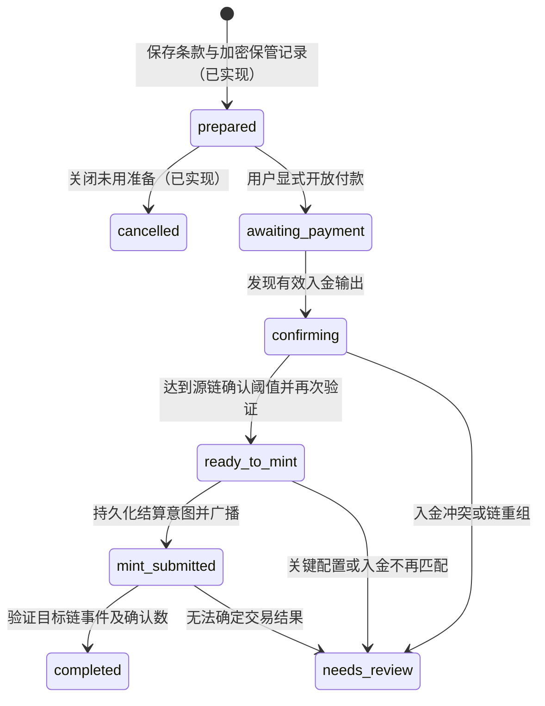
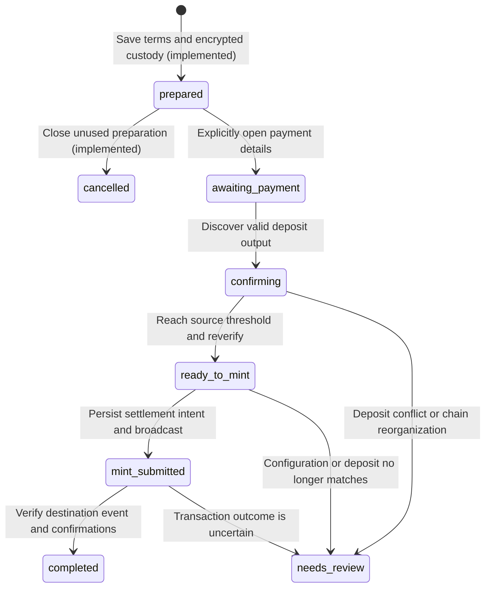

# TBC Testnet → HyperEVM Testnet 学习桥 / Learning Bridge

每节包含中文与英文说明。 / Each section contains Chinese and English text.

## 范围与当前状态 / Scope and current status

### 中文

本项目参考 Turing Bridge 的产品流程，自行实现一个托管式 Lock and Mint 实验。
它不代表官方桥的协议或资产。现有单链 FT HTLC 继续独立存在。
`STUDY2.md` 是老师的原始资料，始终只读。

已实现：两侧钱包连接、路由规格、目标链代币合约源码、本地编译入口、首个 FT 的后端 genesis 核验／PostgreSQL 登记、部署预览、MetaMask 确认部署与后端合约核验／持久化、准备订单与每订单独立的加密保管记录。
已接入显式付款详情、普通 MT 入金验证、MetaMask 确认 unpause／mint 和双链结果核验（第 8 节）。自动 mint worker 和自动退款未实现；反向赎回的 fee、固定释放计划、MetaMask 永久锁定与释放控件已接入（第 12–14 节），首笔反向返回已由 2026-10-29 22:03 MYT 用户截图确认，源链 6/6 确认，见第 16 节。用户于 2026-10-28 确认部署与准备订单，2026-10-29 确认真实入金、unpause、mint、Completed 及 MetaMask 的 1,000,000 lwFT 余额（第 9 节）。首笔往返正常交易已走通；用户随后明确确认 Turing Wallet 已收到返回的 1,000,000 MT，完整异常场景尚未验收。
当前页面支持手动加载并选择钱包 FT，按 Contract ID 读取元数据，再由 **Verify selected FT** 核验批准的 MT genesis。切换钱包、网络或离开标签会清空选择。付款详情须在已保存订单中另行明确开放；资产身份验证不代表已入金或跨链完成。

### English

This project implements an experimental custodial Lock and Mint bridge, taking
inspiration from the Turing Bridge product flow. It does not represent the official
bridge protocol or its assets. The existing single-chain FT HTLC remains separate.
`STUDY2.md` contains the teacher's original material and must always remain read-only.

The proof-oriented successor is currently a design only. Its frozen Phase 0
scope, trust boundary, encoding rules and launch gates are recorded in
[`docs/tbc-hyperevm-bridge-v2-phase-0.md`](../../docs/tbc-hyperevm-bridge-v2-phase-0.md).
It does not change this Learning Bridge's contracts or runtime behavior.

Implemented: wallet connections on both sides, the route specification, the
destination token contract source, a local compilation command, and backend genesis
verification / PostgreSQL registration for the first approved source FT, plus
public Admin/Minter configuration, fee previews, wallet-confirmed deployment and
backend contract verification / persistence, prepared orders and independently
encrypted custody allocation for each order.

Payment details, ordinary MT deposit verification, MetaMask-confirmed unpause/mint
and source/destination result verification are connected; see section 8. Automatic
mint workers and automatic refunds are not implemented. Reverse redemption uses permanent escrow locking and an explicitly authorized MT release. The
user's screenshots on 2026-10-28 confirmed deployment at 4:53 p.m. MYT and order
preparation at 5:59 p.m. On 2026-10-29 the user confirmed funding, unpause, mint,
Completed status and a 1,000,000 lwFT MetaMask balance; see section 9. This accepts
the first forward transfer. The 22:03 MYT screenshot on the same day confirms the MT return with 6/6 source confirmations; see section 16. The user subsequently confirmed that the 1,000,000 MT had returned to Turing Wallet. Comprehensive error handling is not yet accepted.

The page loads wallet FTs by Contract ID and uses **Verify selected FT** to verify
the approved MT genesis. Wallet/network/tab changes clear the selection. Payment
details require a separate explicit action on a saved order. Asset identity
verification alone does not establish a deposit or cross-chain settlement.

## 1. 资产与单位 / 1. Assets and units

### 中文

| 项目 | 首版决定 |
| --- | --- |
| 源网络／资产 | TBC Testnet / 用户选择的普通 legacy FT，以 Contract ID 区分；可以选择已有的 Mega Token |
| 目标网络 | HyperEVM Testnet，chain ID 998 |
| 实验代币名称／符号 | Learning Wrapped Test FT / `lwFT`；每个合约实例只对应一个源 FT |
| 代币精度 | 读取所选 FT 的 decimal，目标 ERC-20 固定使用同一精度；不默认 6 位 |
| 数量映射 | `mintAmountRaw = verifiedDepositAmountRaw`，1:1 |
| 桥服务费 | 首版为 0；链上手续费另付 |
| 交易手续费 | 源链 native test TBC；目标链原生 HYPE，18 位精度 |
| 确认策略 | 源链至少 6 次确认后允许 mint；目标链至少 6 次后订单完成 |

6 次确认是本实验的可调整策略，不能承诺消除链重组风险。订单创建时必须保存
策略版本及阈值，修改默认配置不能悄悄改变旧订单的条款。

所有 raw amounts 在 JSON 中使用十进制整数字符串，计算使用 `bigint`／Solidity
`uint256`，不使用浮点数。源 FT 与 lwFT 精度相同，因此 raw units 直接 1:1 映射。
例如源 FT 为 2 位时，`1.25 FT = 125` raw units，目标也 mint `125` raw units。
HYPE 的 18 位、native TBC 的 6 位只用于各自手续费，不决定 FT 的精度。

公开路由规格：`src/config/learningBridge.ts`。其中不放私钥或尚未部署的合约地址。

### English

| Item | First-version decision |
| --- | --- |
| Source network / asset | TBC Testnet / one selected ordinary legacy FT, identified by Contract ID; an existing Mega Token may be selected |
| Destination network | HyperEVM Testnet, chain ID 998 |
| Experimental token name / symbol | Learning Wrapped Test FT / `lwFT`; one source FT per contract instance |
| Token decimals | Read the selected FT decimal metadata and pin the same precision in the destination ERC-20; do not default to 6 |
| Amount mapping | `mintAmountRaw = verifiedDepositAmountRaw`, 1:1 |
| Bridge service fee | Zero for the first version; network fees are paid separately |
| Network fees | Native test TBC on the source chain; native HYPE with 18 decimals on the destination chain |
| Confirmation policy | At least 6 source confirmations before minting; at least 6 destination confirmations before completing an order |

Six confirmations is an adjustable policy for this experiment, not a guarantee
against chain reorganizations. Each order must preserve its policy version and
confirmation thresholds at creation. Changing defaults must not silently change
the terms of existing orders.

All raw amounts use decimal integer strings in JSON. Calculations use `bigint` or
Solidity `uint256`, never floating-point numbers. The source FT and lwFT use the
same decimals, so raw units map directly 1:1. For a source FT with 2 decimals,
`1.25 FT = 125` raw units; mint `125` destination raw units as well. HYPE's 18
decimals and native TBC's 6 decimals apply to their network fees, not to FT precision.

The public route specification lives in `src/config/learningBridge.ts`. It contains
no private keys or addresses for contracts that have not been deployed.

## 2. 信任与账户职责 / 2. Trust model and account responsibilities

### 中文

- 用户：用 Turing Wallet 转入所选 FT，并另外用 native test TBC 支付手续费；确认接收 lwFT 的 EVM 地址。
- 保管方：控制源链入金地址及其私钥，保管已经收到的指定 FT。
- 验证／结算服务：读取固定的 TBC Testnet 数据源，验证入金，使用指定 minter
  账户发起目标链 mint，承担 HYPE gas。
- 管理员：目标链合约 owner，负责暂停／恢复 mint、轮换 minter。管理员可以控制
  铸币权限，因此仍然属于信任范围。

用户通过 MetaMask 接收代币，不需要授权任何人花费其 HYPE。部署者需要 HYPE；
自动结算的 minter 也需要 HYPE。连接用户的钱包不会自动提供后端签名权限。
后端为准备订单生成独立地址并加密保管私钥，显式开放付款后才显示地址。目标链签名由 MetaMask 逐笔确认，后台没有 EVM 私钥。owner／minter 在部署表单明确选择并通过实际部署核验；连接钱包本身不代表这些权限。

源链的“Lock”在这里指转入桥控制的保管地址。资金不受原 HTLC 的 hashlock 或
退款时间保护；用户必须信任运营方。目标链合约无法自行证明指定 FT 已入金，
受信 minter 仍可能为伪造的源链记录 mint。去重规则只能防重复，不能证明储备。

### English

- **User:** transfers the selected FT through Turing Wallet, pays network fees
  separately in native test TBC, and confirms the EVM recipient for lwFT.
- **Custodian:** controls the source deposit addresses and their private keys,
  holding the selected FT received.
- **Verification and settlement service:** reads a fixed TBC Testnet data source,
  verifies deposits, submits destination mint transactions through the designated
  minter account, and pays HYPE gas.
- **Administrator:** owns the destination contract and can pause or resume minting
  and rotate the minter. This account controls minting permissions and therefore
  remains part of the trust model.

Users receive tokens through MetaMask without authorizing anyone to spend their
HYPE. The deployer needs HYPE, as does the minter used for automatic settlement.
Connecting a user's wallet does not grant the backend signing authority.
The backend can generate an independent address and encrypt its private key for
each prepared order. Payment details open explicitly; custody spending is not
enabled. MetaMask confirms each target transaction; the backend has no EVM private
key. Owner/minter roles are selected during deployment and verified afterward.
Connecting a wallet alone does not grant these roles.

Here, source-chain “Lock” means transferring funds to an address controlled by
the bridge custodian. Those funds are not protected by the existing HTLC's
hashlock or refund deadline; users must trust the operator. The destination
contract cannot independently prove that a deposit of the selected FT happened. A trusted
minter could still mint against a fabricated source record. Replay protection
prevents duplicate processing; it does not prove reserves.

## 3. 正向流程与状态 / 3. Forward flow and states

### 中文



首版采用每订单独立的保管入金地址。由后端安全生成／分配并持久化，地址与订单
必须唯一绑定；不会通过前端随机填写或复用其他订单地址来分配入金。
地址生成、独立主密钥与本地备份、认证加密存储已实现。prepared 时隐藏地址，
用户明确确认后才开放付款；首笔真实入金与钱包确认 mint 已于 2026-10-29 验收，详见第 9 节。

1. 用户确认源资产、数量和目标地址；服务端验证钱包登录签名／会话，冻结订单
   接收地址、数量、网络、目标合约和确认策略。不能仅信任请求体里的钱包地址。
2. 持久化订单与唯一入金地址，同时冻结 source Contract ID、FT 协议、真实 decimals 和绑定的目标 ERC-20 合约；之后才向用户显示付款指引。
3. 用户通过 Turing Wallet 转入该 FT，native TBC 另付手续费；后端发现或接收 TXID 后自行查询原始交易和 FT genesis／证明。
4. 按源 Contract ID 验证 genesis 和普通 legacy FT 协议，验证 FT code 输出与配对 Tape／祖先证明一致，且归属于订单保管地址。从 Tape 读取真实 FT raw amount，而不是把输出上的 native TBC satoshis 当作 Token 金额。记录 FT code 输出的 `txid:vout`（及配对 Tape 索引）、区块哈希、高度及确认数。首版仅接受一个有效 FT code／Tape 输出组中的精确数量；不同 Contract ID、TBC20／stablecoin、不足、超额、多笔或多组聚合都不自动 mint。
5. 达到确认阈值后重新核验入金仍在规范链上，再进入结算队列。
6. 使用固定合约与 minter，提交 `mintFromDeposit`；记录结算尝试、nonce、交易哈希。
7. 核对成功 receipt、合约地址、`DepositMinted` 事件及订单绑定数据；满足目标链
   确认阈值后才标记 `completed`，页面关联两侧交易。

RPC 超时不会变成“付款失败”或重新分配地址。记录 `lastCheckError` 和上次结果，
保留业务状态，提供可控重试。mint 提交结果不明确时必须先对账，不能生成另一
笔新付款或无条件重发 mint。重组发生在 mint 后时暂停自动结算并人工对账。

首版不自动过期已发放的入金地址，不宣称时间到了就自动退款。以后如增加付款
截止时间，必须先设计迟到付款／人工退款规则；它与旧 HTLC 的链上退款条件不同。

### English



The first version assigns a separate custody deposit address to each order.
The backend must securely generate or allocate and persist these addresses, with
a unique binding between each address and its order. The frontend must not assign
deposits by accepting arbitrary addresses or reusing another order's address.
Address generation, an independent master key with a local backup, and authenticated
encrypted storage are implemented. Prepared orders hide their addresses until
the user explicitly opens payment details. Verification and wallet-confirmed mint
are connected; the first funded transfer was accepted on 2026-10-29 (section 9).

1. The user confirms the source asset, amount, and destination address. The server
   verifies the wallet login signature or session and freezes the order's
   recipient, amount, source Contract ID, FT protocol, decimals, networks, destination contract, and confirmation policy.
   A wallet address in the request body alone is not sufficient authentication.
2. Persist the order and its unique deposit address before showing payment
   instructions to the user.
3. The user transfers the selected FT through Turing Wallet, paying native TBC
   fees separately. The backend independently retrieves the transaction and FT
   genesis/proofs after discovering or receiving a TXID.
4. Validate the genesis and ordinary legacy FT protocol for the source Contract ID.
   Verify the FT code output, paired Tape, ancestry proofs, and custody recipient.
   Read the actual FT raw amount from the Tape, not the output's native TBC satoshis.
   Record the FT code output's `txid:vout`, paired Tape index, block hash, height,
   and confirmations. Accept only the exact amount in one valid code/Tape output
   group. A different Contract ID, TBC20/stablecoin, underpayment, overpayment, or
   aggregation across payments or groups must not trigger automatic minting.
5. After reaching the source confirmation threshold, verify again that the
   deposit remains on the canonical chain, then queue it for settlement.
6. Submit `mintFromDeposit` using the pinned contract and designated minter.
   Record the settlement attempt, nonce, and transaction hash.
7. Verify a successful receipt, the contract address, the `DepositMinted` event,
   and its order bindings. Mark the order `completed` only after reaching the
   destination confirmation threshold, and link both transactions in the UI.

An RPC timeout must not become a “payment failed” result or cause a new deposit
address to be allocated. Record `lastCheckError` and the previous result, preserve
the business state, and allow controlled retries. If mint submission has an
uncertain outcome, reconcile first. Do not create a new payment or blindly submit
another mint. If a source reorganization occurs after minting, pause automatic
settlement and reconcile manually.

The first version does not automatically expire issued deposit addresses or
promise an automatic refund after a deadline. Any future payment deadline must
first define late-payment and manual-refund rules. Those rules are separate from
the existing HTLC's on-chain refund conditions.

## 4. 订单与幂等约束（后端待实现） / 4. Order data and idempotency constraints — backend pending

### 中文

订单至少保存：

- `orderId`：服务端生成的非零随机 `bytes32`，同时用作合约的订单去重键。
- `routeId`、策略版本、源网络身份、目标 chain ID、已验证的目标合约地址。
- 登录钱包身份、source Contract ID／FT 协议、冻结的 EVM recipient、`amountRaw`、两侧 decimals 和费用规则。
- 唯一 deposit address、其锁定脚本、派生索引引用；不把保管私钥返回浏览器。
- 源交易 TXID／vout／区块哈希／确认数及最后核验时间。
- 状态、目标结算尝试／nonce／交易哈希／区块／确认数、错误及时间戳。

数据库必须有唯一约束：

1. order ID；客户端创建订单的幂等键也要绑定登录身份和不可变请求参数。
2. 源网络＋deposit address，只分配给一个订单。
3. 源网络＋TXID＋vout，一个输出只能结算一次。
4. 目标 chain ID＋合约地址＋order ID，一个订单只保留一个有效结算结果。

使用数据库事务和 worker 租约／锁领取任务。保存签名交易或可恢复的结算意图，
再广播；重启后查询 receipt、合约去重映射及事件，核对参数后继续处理。
不能用“前端按钮 disabled”代替后端幂等性，也不能仅看映射为 true 就认定该
订单成功，必须核对原 mint 的接收人、金额和入金输出。

TBC 地址前缀不能代替网络核验。后端必须使用固定 Testnet 数据源并核对节点
网络身份／链锚点。浏览器传入的 confirmation、余额或“已付款”标签不能作为证明。
目标链同样核对 `eth_chainId`、合约代码及部署记录，不能接受浏览器提供的合约地址。

### English

Each order must store at least:

- `orderId`: a nonzero random `bytes32` generated by the server, also used as the
  contract's order replay-protection key.
- `routeId`, policy version, source network identity, destination chain ID, and
  the verified destination contract address.
- Authenticated wallet identity, source Contract ID and FT protocol, frozen EVM
  recipient, `amountRaw`, decimals on both sides, and fee rules.
- Unique deposit address, its locking script, and a derivation-index reference.
  Custody private keys must never be returned to the browser.
- Source TXID, vout, block hash, confirmations, and last verification time.
- State, destination settlement attempts, nonce, transaction hash, block,
  confirmations, errors, and timestamps.

The database must enforce uniqueness for:

1. Order ID. The client's order-creation idempotency key must also bind the
   authenticated identity and immutable request parameters.
2. Source network plus deposit address: an address belongs to only one order.
3. Source network plus TXID plus vout: a payment output can be settled only once.
4. Destination chain ID plus contract address plus order ID: an order has only
   one valid settlement result.

Use database transactions and worker leases or locks to claim work. Persist the
signed transaction or a recoverable settlement intent before broadcasting.
After a restart, query receipts, the contract's replay-protection mappings, and
events; verify their parameters before continuing.

A disabled frontend button does not replace backend idempotency. A mapping value
of `true` alone does not prove that the order succeeded: the original mint's
recipient, amount, and deposit output must also match.

A TBC address prefix is not proof of network identity. The backend must use a
fixed Testnet data source and verify node network identity or chain anchors.
Browser-supplied confirmations, balances, and “paid” labels are not evidence.
On the destination chain, verify `eth_chainId`, deployed code, and deployment
records. Do not accept a contract address supplied by the browser.

## 5. 目标链合约 / 5. Destination contract

### 中文

源码：`contracts/LearningWrappedFT.sol`。

- 固定名称 `Learning Wrapped Test FT`，符号 `lwFT`，初始总量 0。一个实例仅绑定一个源 FT，不能混存不同资产。
- 构造函数接收 admin、initialMinter、非零 `sourceContractId`（bytes32）和 `sourceDecimals`（uint8）；后两项不可修改，ERC-20 decimals 与源 FT 相同。部署前由后端核对真实元数据，只允许部署到 chain 998。
- 只有 minter 能调用 `mintFromDeposit(orderId, sourceContractId, sourceTxid, sourceVout, recipient, amountRaw)`。
- 非零订单、TXID、接收地址和数量校验；禁止 mint 到合约自身；mint 参数的 source Contract ID 必须与部署时绑定值相同。
- 同时消耗订单和源入金输出的去重标记，然后 mint 并发出 `DepositMinted`。
- owner 可轮换 minter；初始暂停 mint，配置及验证服务就绪后再由 owner 恢复。
- 暂停仅阻止新 mint，已有 ERC-20 transfer 不受影响。
- 所有权转移使用两步确认；禁用 renounce，保留暂停及轮换权限的管理者。
- 暂不开放 burn／赎回，避免销毁后没有源链释放服务。普通 transfer 不会释放源链 FT。
- 无 payable 入口、公开 mint、预铸或通用资产提取函数。

去重哈希定义：

```text
SOURCE_DOMAIN = keccak256(UTF8("learning-bridge/tbc-testnet/legacy-ft/v1"))
depositId = keccak256(abi.encode(SOURCE_DOMAIN, sourceContractId, bytes32(sourceTxid), uint32(vout)))
```

源 Contract ID 与 TXID 均按 TBC API 展示顺序转为 bytes32，不倒序。`vout` 是从 0 开始的 FT code 输出索引，不是 Tape 或手续费找零索引。
合约提供 `depositId` 方法，服务端不应自行改成 SHA-256 或 packed 编码。
映射仅保护本合约实例，重新部署不能清空后端已结算输出记录或重放旧入金。

### English

Source: `contracts/LearningWrappedFT.sol`.

- Fixed name `Learning Wrapped Test FT`, symbol `lwFT`, and zero initial supply.
  Each instance represents exactly one source FT; different assets cannot share it.
- The constructor takes admin, initialMinter, a nonzero bytes32 `sourceContractId`,
  and uint8 `sourceDecimals`. The source identity and decimals are immutable;
  ERC-20 decimals match the source FT. The backend must verify actual metadata
  before deployment. Deployment is restricted to chain 998.
- Only the minter may call
  `mintFromDeposit(orderId, sourceContractId, sourceTxid, sourceVout, recipient, amountRaw)`.
- Reject zero order IDs, TXIDs, recipient addresses, and amounts. Minting to the
  contract itself is also rejected. The mint request's source Contract ID must
  match the value pinned at deployment.
- Consume both the order and source deposit output replay-protection keys, then
  mint and emit `DepositMinted`.
- The owner may rotate the minter. Minting starts paused and must be resumed by
  the owner after configuration and the verification service are ready.
- Pausing blocks new mints only; existing ERC-20 transfers remain available.
- Ownership transfers require two steps. Renouncing ownership is disabled so an
  administrator remains able to pause minting and rotate the minter.
- Burn and redemption are not exposed yet, to avoid destroying tokens before a
  source-chain release service exists. Ordinary transfers do not release the source FT.
- No payable entry point, public mint, premine, or general asset-withdrawal function.

The deposit replay-protection hash is defined as:

```text
SOURCE_DOMAIN = keccak256(UTF8("learning-bridge/tbc-testnet/legacy-ft/v1"))
depositId = keccak256(abi.encode(SOURCE_DOMAIN, sourceContractId, bytes32(sourceTxid), uint32(vout)))
```

Convert both the source Contract ID and TXID to bytes32 in TBC API display order,
without reversing bytes. `vout` is the zero-based FT code output index, not the
Tape or native fee-change output index. The contract exposes a
`depositId` method; the server must not substitute SHA-256 or packed encoding.
The mappings protect only this contract instance. Redeploying must not clear
backend records of settled outputs or allow old deposits to be replayed.

## 6. 编译与后续部署 / 6. Compilation and deployment preparation

### 中文

在 `wallet/` 中执行：

```sh
npm install
npm run contracts:compile
```

固定 Solidity `0.8.30`、OpenZeppelin Contracts `5.4.0`，optimizer runs 200，
明确目标 EVM 为 `cancun`。输出 `artifacts/LearningWrappedFT.json`，包含 ABI、
创建／运行字节码、编译输入与其 SHA-256、编译版本和 metadata；此 JSON 不提交 Git。
同一编译命令还生成并提交 `shared/src/contracts/learningWrappedFT.ts`，包含构造 ABI、创建字节码、运行字节码／不可变参数位置和构建／源码指纹。NestJS 从这个共用产物编码及核验部署；修改 Solidity 后须重新编译，不能手改生成模块。
编译器版本、依赖版本或 Solidity 编译错误不匹配会终止构建。

`solc` 的开发依赖 `tmp` 单独 override 为修复版本 `0.2.7`。项目原有的
Vite、source-map-js 与 TBC SDK 依赖另有 npm audit 报告，不能把编译成功当作
依赖安全或合约行为验收。未执行合约行为测试；真实部署与首笔 mint 已完成，见第 9 节。

首个源 FT 已选为 Mega Token (MT)，Contract ID `ac54e83d476839a11bbb7d0a2495e50c9d0d23c9283f94e11222bad589259e6c`，1 位精度，legacy FT v3。先点击 **Verify selected FT**，再使用 **Deployment preview → Estimate deployment fee**。默认使用当前 MetaMask 地址作为 deployer、Admin 和 Minter；取消勾选后可填写独立 Admin／Minter 的公开地址。

NestJS 的 `POST /api/bridge/deployments/preview` 要求 TBC 登录、CSRF 和 10 分钟内成功的源资产核验，只使用固定官方 Testnet RPC、chain 998 和服务端编译产物。真实构造参数为 Admin、Minter、MT Contract ID、精度 1。读取最新区块、余额及 gas price，调用 `eth_estimateGas`，展示原始估算、增加 20% gas units 后的预算及余额差额。余量不保障未来 gas price；报价 60 秒后失效，切换钱包／网络／角色或离开标签会清除预览。它不写部署记录，也不证明 EVM 地址的控制权。

准备部署：点击 **Prepare deployment**，后端重新估算，保存当次角色、构造数据、编译产物快照及 pending nonce。勾选已检查参数后点击 **Deploy with MetaMask**；服务端再次检查费用、余额和 nonce，在数据库领取一次性发送状态，前端逐字节核对构造数据并重新读取 MetaMask 账户／网络，然后只打开一次 `eth_sendTransaction`。没有后台私钥或自动部署；该交易只创建合约，不发送代币或解除 mint 暂停。

`bridge_deployments` 保存 prepared → awaiting_wallet → submitted → confirming → verified，另有 cancelled／reverted／invalid；同用户路由与同部署者 nonce 均有活跃记录唯一约束。只有登录的原 TBC 身份能管理记录。刷新或切换标签不重发交易，回到标签后读取数据库历史。收到钱包哈希但 API 保存失败时，只把公开的记录 ID／哈希临时放入 sessionStorage，原钱包重连后重试保存；也可从 MetaMask Activity 手动补填哈希。未知发送结果时先检查 Activity，不自动重试。Discard 仅关闭未使用的本地准备记录，不能取消钱包请求或链上交易。

后端使用固定 chain 998 RPC 核对创建交易的 sender／nonce／to／value／全部 input、规范收据区块和 CREATE 地址。达到 6 次确认后，比较运行字节码（仅屏蔽 solc 明确标记的不可变参数位置），并在部署区块读取 source Contract ID、decimals、owner、minter、paused、totalSupply、名称／symbol／chain 常量；要求初始暂停且零供应。核验通过才保存 verified 和地址，实际手续费从收据计算。查询失败显示 Status unavailable 并保留旧结果；重组会重新进入待验证状态。

页面只在标签激活时进行有界部署状态查询（每轮最多 18 次，5 秒间隔），之后手动刷新，不是后台 worker。验证描述创建区块的初始状态，不保证管理员之后从未修改合约，也不会把用户部署自动设为全局桥结算合约。入金验证与钱包确认 unpause／mint 已接入，见第 8–9 节；后端没有 EVM 签名私钥。

### English

Run from `wallet/`:

```sh
npm install
npm run contracts:compile
```

The build pins Solidity `0.8.30` and OpenZeppelin Contracts `5.4.0`, enables the
optimizer with 200 runs, and explicitly targets the `cancun` EVM version.
It writes `artifacts/LearningWrappedFT.json`, containing the ABI, creation and
runtime bytecode, build input and its SHA-256, compiler version, and metadata.
That JSON artifact is not committed to Git. The same command also generates the
committed `shared/src/contracts/learningWrappedFT.ts` with the constructor ABI,
creation/runtime bytecode, immutable-reference locations and build/source fingerprints. Recompile after
Solidity changes; do not edit the generated module manually. A compiler or dependency version
mismatch, or a Solidity compilation error, stops the build.

The compiler's development dependency `tmp` is overridden to the patched version
`0.2.7`. Existing Vite, source-map-js, and TBC SDK dependencies have separate npm
audit findings. Successful compilation does not establish dependency security or
correct contract behavior. Contract behavior tests have not been run. Deployment
and the first mint have completed; see section 9.

The first source FT is Mega Token (MT), Contract ID
`ac54e83d476839a11bbb7d0a2495e50c9d0d23c9283f94e11222bad589259e6c`,
with 1 decimal and legacy FT v3. **Verify selected FT** calls the backend verifier
and registry. Then use **Deployment preview → Estimate deployment fee**. The
connected MetaMask account is the deployer and, by default, Admin and Minter;
uncheck the option to enter separate public role addresses.

`POST /api/bridge/deployments/preview` requires TBC login, CSRF and source asset
verification within the last 10 minutes. NestJS uses the fixed official Testnet
RPC, chain 998 and server build to encode the actual constructor arguments. It
reads the latest block, balance and gas price, calls `eth_estimateGas`, and shows
the estimate, a budget with 20% additional gas units and any balance shortfall.
The margin does not protect against gas price increases. Quotes expire after 60
seconds and clear on wallet/network/role/tab changes. A preview does not prove
control of the supplied EVM addresses or persist a deployment record.

Use **Prepare deployment** for a fresh estimate and durable snapshot of roles,
constructor data, the compiler build and pending nonce. Review the saved quote,
check the acknowledgement, then click **Deploy with MetaMask**. The server
rechecks fees/balance/nonce and claims a single-use sending state. The frontend
compares every creation-data byte and rechecks the wallet account/network before
one explicit `eth_sendTransaction`. There is no backend deployment key, automatic
send, token transfer or unpause operation.

The owner-scoped `bridge_deployments` lifecycle is prepared → awaiting_wallet →
submitted → confirming → verified, with cancelled/reverted/invalid outcomes.
Partial unique indexes protect active user/routes and deployer/nonces. Reloading
or switching tabs never sends again. Public record-id/hash pointers temporarily
use sessionStorage only if saving a returned hash failed; reconnect the original
TBC wallet to retry saving, or recover the hash from MetaMask Activity. Unknown
sending outcomes require checking Activity before retrying. Discarding a local
preparation cannot cancel an open wallet request or an on-chain transaction.

The fixed testnet RPC verifies sender/nonce/to/value/full input, the canonical
receipt block and CREATE address. After 6 confirmations, runtime bytecode is
compared with the saved build, masking only solc immutable-reference locations.
Reads at the creation block verify the FT binding, decimals, owner, minter, paused
state, zero supply, name/symbol and chain constant. Only then is the deployment
marked verified. Receipt gas usage/price determine its actual fee. Failed reads
show Status unavailable with the previous result retained; reorgs invalidate a
saved verification until the canonical receipt can be checked again.

Status watching is bounded (18 requests per round, 5-second gaps), runs only while
the tab is active, and supports manual refresh. Verification records the initial
creation-block state and does not promise that administrators never changed it
later. A personal deployment does not automatically activate the global bridge
settlement contract. Prepared orders, encrypted custody, deposit validation and
wallet-confirmed unpause/mint are connected (sections 8–9). The backend has no EVM signing key.

## 7. 准备订单阶段记录 / 7. Order preparation stage

### 中文

用户已完成的部署（2026-10-28 4:53 p.m. MYT 截图及数据库记录）：

| 项目 | 实际结果 |
| --- | --- |
| HyperEVM Testnet | chain 998 |
| lwFT 合约 | `0xd464680f3d1e9a5365787ae37489c5b3b4a6bf0d` |
| 部署交易 | `0x405cfeab3a44f352bc77d25257c5148bdd5a6ca93747c7e0425213c6a4e969ee` |
| 部署手续费 | `0.000110059 HYPE` |
| 初始状态核验 | MT、精度 1、owner／minter 正确，paused，供应 0 |

不需要再次部署。重新选择 MT 并 **Verify selected FT**，然后在 **Bridge orders**
刷新已保存部署，填入少量 MT（例如 `10`）和接收地址，检查 **Review order** 后
**Save prepared order**。这一步只写数据库与分配加密保管记录，不要求钱包资金签名。

服务端在创建前重新检查当前合约状态。冻结源 FT、精度、raw amount、TBC 发送者、
HyperEVM 接收地址、目标合约、确认阈值和策略版本。请求 ID 在同一 review 的重试中
保持不变，相同条款返回原订单，冲突则报错；每个 TBC 身份最多 3 个未关闭准备。
可关闭未使用准备，但加密地址记录保留且永不复用。标签／钱包／网络切换清空表单，
订单历史仍在 PostgreSQL。响应超时先刷新历史，不自动重新创建。

后台每订单生成独立 compressed P2PKH 保管地址，私钥以 HKDF-SHA256 派生的 AES-256-GCM
密钥加密，AAD 绑定网络、身份、订单、条款和地址。独立主密钥位于
`.secrets/bridge-custody.key`，Compose 只挂载给 backend，不放入数据库／前端／镜像。
setup 保留已有密钥，并在 `.backups/bridge-custody.key` 留本地初始副本；数据库与
匹配密钥仍须另作异地备份。数据库 key fingerprint 不匹配会禁止分配。详细恢复限制
见 [后端架构](../../docs/backend-architecture.md)。

此阶段初版只显示 **Prepared / Closed**；付款地址强制隐藏，`paymentEnabled=false`，
当时没有付款按钮、入金 TXID 提交或 mint。准备本身不会产生 lwFT，也不是 HTLC
自动退款。现在接通的付款与钱包确认结算步骤见第 8 节。

### English

The user's screenshot at 4:53 p.m. MYT on 2026-10-28 and the saved deployment
record confirm chain 998 contract
`0xd464680f3d1e9a5365787ae37489c5b3b4a6bf0d`, transaction
`0x405cfeab3a44f352bc77d25257c5148bdd5a6ca93747c7e0425213c6a4e969ee`,
and an actual fee of `0.000110059 HYPE`. The initial MT binding, 1 decimal,
owner/minter, paused state and zero supply were verified.

Do not deploy again. Select MT and **Verify selected FT** again, then refresh
**Bridge orders**, enter a small MT amount and receiving address, review the terms,
and **Save prepared order**. This saves database records and allocates custody;
it does not sign or send a funds transaction.

The backend rechecks the current target contract. It freezes the FT, decimals,
raw amount, authenticated TBC sender, EVM recipient, destination contract,
confirmation thresholds and policy version. Retries of the same review retain
their request ID and return the same order; conflicting terms fail. Each identity
may have 3 open preparations. Closing an unused preparation retains its encrypted
custody record and never reuses its address. Tab/wallet/network changes clear
inputs while database history persists. After a timeout, refresh saved orders;
the page does not automatically create another order.

Each order receives an independent compressed P2PKH custody address. The backend
uses HKDF-SHA256 to derive a per-order AES-256-GCM key; authenticated data binds
the network, identity, order, frozen terms and address. The separate master key
is `.secrets/bridge-custody.key`, mounted only into the backend, excluded from
the database, frontend and image. Setup preserves existing keys and keeps an
initial local copy at `.backups/bridge-custody.key`. Back up the database and
matching key separately outside this computer. A database key-fingerprint mismatch
blocks allocation. See the [architecture guide](../../docs/backend-architecture.md)
for recovery and trust limits.

The initial preparation stage exposed only **Prepared / Closed**, returned
`paymentEnabled=false` and withheld payment addresses. Preparation alone creates
no lwFT and is separate from HTLC refunds. The subsequently connected payment and
wallet-confirmed settlement workflow is described in section 8.

## 8. 入金与钱包确认 mint / 8. Deposit and wallet-confirmed mint

TBC 只读查询遇到网络错误、超时或临时 HTTP 错误时，每个查询最多再试一次；取消会中断等待。失败的接口路径、状态和错误分类写入后端日志。仍无法读取时保留原订单与入金证据，阻止继续发送；不会使用旧核验结果跳过检查，也不会自动重发付款或钱包交易。

Each read-only TBC query retries once on a network error, timeout or temporary HTTP failure, within the operation's cancellation deadline. Backend logs identify the failed endpoint, status and error category. Unavailable fresh evidence blocks sending while retaining the order and deposit records. Previous verification never replaces fresh checks; payments and wallet transactions are never retried automatically.

2026-10-29 排错：用户 Console 确认 MetaMask 的 pending nonce 返回数字 `1`，而固定 RPC 与已保存报价为 `0x1`。前端已兼容非负安全整数与十六进制字符串，统一为 bigint 后严格比较；小数、负数、超出安全范围及无效响应仍被拒绝。这次失败发生在 `eth_sendTransaction` 之前，没有打开交易确认。

Troubleshooting on 2026-10-29: the user's console confirmed a numeric pending nonce (`1`), matching the fixed RPC and saved quote (`0x1`). The frontend now accepts nonnegative safe integers and hex strings, converts them to bigint and compares them exactly. Fractions, negative values, unsafe integers and invalid responses remain rejected. This failure happened before `eth_sendTransaction`, so no transaction approval was opened.

### 中文

用户于 2026-10-28 5:59 p.m. MYT 截图验收准备成功：**1,000,000 MT**，订单
`0a5f889d-c673-4856-814e-a091f1d4fa3e`，接收地址和目标合约已冻结。
这不是付款或 mint 记录。现有订单无需重建，按以下步骤继续：

1. 在已保存订单点击 **Open payment details** 前，确认理解托管、精确金额和无自动
   退款。后台先验证原保管密文可恢复、源链 checkpoint 和目标合约，再显示唯一地址。
2. 在 **Turing Wallet → MT → Send** 使用此地址和订单的精确 MT 数量，检查 native
   TBC 手续费后确认一笔普通 FT 转账。保留钱包 TXID；不要因接口慢而重复付款。
3. 粘贴 TXID，**Verify source deposit**；随后 **Recheck source deposit** 直到至少
   6 次确认。校验 raw／genesis／Code／Tape／输入归属／金额槽和找零、解锁脚本、
   indexer 的指定 MT 未花费输出及规范区块。数量不符、多组、批量或不同 FT 不自动接受。
4. 若合约仍暂停，MetaMask 选择已保存 admin，**Estimate admin unpause**，检查费用并
   勾选确认后发起 unpause；**Check transaction status** 等待目标 6 次确认。
   若合约已解除暂停，可直接用 minter 准备 mint。
5. MetaMask 选择已保存 minter，**Estimate mint**，检查数量、接收地址、合约和 HYPE
   预算，确认 mint。报价 60 秒，发送前重新核验源入金、目标状态、nonce 与费用。
6. **Check transaction status** 核对成功收据、规范区块、唯一匹配 DepositMinted
   事件和去重标记；双链确认均达标后显示 **Completed**。
7. **Add lwFT to MetaMask**，切到 HyperEVM Testnet（998）的接收账户查看余额。
   测试代币可能没有法币价格。不会自动导入、自动付款或后台自动签名。

源链 `txid:vout` 在数据库全局唯一，不能跨订单或重新部署后复用。order bytes32 key
使用 SHA-256 `learning-bridge/order/v1:<UUID>`，前端独立核对完整 ABI 数据。后台没有
MetaMask 私钥；每笔发送前持久化一次性钱包请求状态。未知结果先查 Activity，用哈希
恢复；只有确认拒绝／未发送后才可丢弃本地请求，它不能取消链上交易。刷新不重发。

开放地址后不能关闭为 unused，无付款过期或自动退款。原保管密文永久保留；后台尚不
签署源链释放。这里信任固定 tbcdev 节点／FT indexer 的包含性与祖先归属，不是独立
SPV。源重组、发送后确认下降、已花费输出或不匹配目标证据进入对账流程，不能盲重试。
当前进度使用手动检查按钮，未运行自动化测试；首笔真实入金、unpause、mint 与余额
已验收，完整异常场景仍待验收。实现及数据库约束见 [后端架构](../../docs/backend-architecture.md)。

### English

The user's screenshot at 5:59 p.m. MYT on 2026-10-28 confirmed a prepared order for
**1,000,000 MT**, ID `0a5f889d-c673-4856-814e-a091f1d4fa3e`, with frozen recipient
and target contract. That screenshot does not establish payment or minting. Keep
this order and continue:

1. Acknowledge custody, the exact amount and no automatic refund, then **Open
   payment details**. The backend authenticates recovery of the saved custody key,
   checks the source checkpoint and target contract, then reveals its unique address.
2. In **Turing Wallet → MT → Send**, send the exact order amount to that address
   in one ordinary FT transfer. Review its native TBC fee and keep its TXID.
3. **Verify source deposit**, then **Recheck source deposit** until 6 source
   confirmations. Validation checks raw/genesis/Code/Tape identity, sender inputs,
   amount allocation and change, unlocking scripts, the contract-specific unspent
   output and canonical block. Different assets, wrong amounts and payment
   aggregation are not accepted automatically.
4. If paused, select the saved admin in MetaMask, **Estimate admin unpause**, review
   its HYPE budget, and confirm the wallet call. **Check transaction status** until
   verified with 6 target confirmations. If already unpaused, proceed with the minter.
5. Select the minter, **Estimate mint**, review recipient/amount/contract/fee, then
   confirm in MetaMask. Quotes expire in 60 seconds; source proof, target state,
   role, nonce and fees are rechecked before sending.
6. **Check transaction status** verifies the receipt, canonical block, unique
   matching DepositMinted event and replay markers. Both thresholds must pass
   before **Completed**.
7. **Add lwFT to MetaMask** and view the receiving account on HyperEVM Testnet
   (998). Test tokens may have no fiat price. Importing and transactions are explicit.

Source outpoints have a database-wide unique reservation across orders and target
deployments. The bytes32 order key is SHA-256 of `learning-bridge/order/v1:<UUID>`;
the frontend independently compares all ABI words. The backend has no MetaMask
private key. A persistent wallet-send slot prevents refresh from sending again.
Recover unknown results from Activity hashes. Discard only a confirmed rejected
or unsent local request; discarding cannot cancel a chain transaction.

Opened payment addresses cannot be closed as unused, expire, or trigger automatic
refunds. Custody ciphertext is retained; source release is not implemented. The
fixed tbcdev node/indexer is trusted for inclusion and FT ancestry, not independently
verified through SPV. Reorgs, lost confirmations after sending, spent outputs or
conflicting target evidence require reconciliation. Status checks are manual.
No automated tests were run. The first funded deposit/unpause/mint/balance flow
was accepted; comprehensive error flows remain unverified. See the [architecture guide](../../docs/backend-architecture.md).

## 9. 首笔正向完成记录 / 9. First completed forward transfer

2026-10-29（MYT）：用户 2:34 p.m. 截图确认 unpause 已发送，2:35 p.m. 截图显示订单 **Completed**，2:37 p.m. MetaMask 显示 **1.00M lwFT**。以下公开交易与费用同时读取自数据库的 verified 记录；确认数是读取时的记录，并非实时查询。

On 2026-10-29 (MYT), the user's screenshots confirmed unpause submission at 2:34 p.m., **Completed** at 2:35 p.m. and **1.00M lwFT** in MetaMask at 2:37 p.m. Public hashes and fees below also match the database's verified records. Confirmation counts describe those records when read, not live chain state.

| 项目 / Item | 记录 / Record |
| --- | --- |
| Order | `0a5f889d-c673-4856-814e-a091f1d4fa3e` |
| Amount | 1,000,000 MT → 1,000,000 lwFT; decimals 1; raw `10000000` |
| Source TXID · vout | `3bae1fe926e1ac620ad5c0697c6352af7f0b7d26a459122cbb1a8376e1032b1d` · `0` |
| Source fee | `0.000242 TBC` |
| Target chain | HyperEVM Testnet · `998` |
| Token contract | `0xd464680f3d1e9a5365787ae37489c5b3b4a6bf0d` |
| Recipient | `0x8221fae04189f1f2f50268495ed95d1a9b220432` |
| Unpause TX | `0x3f48c5635941afbd7b172a66ef8c2cedf6f1acea315fd65cfd97feb524e5dc21` |
| Unpause result / fee | verified · 69 confirmations · `0.0000024929 HYPE` |
| Mint TX | `0x2eaa3fa9aa234dc502a82c86f1c4462af60c02918d7a5ae7462f1ac1ecce6906` |
| Mint result / fee | verified · 21 confirmations · `0.0000122896 HYPE` |

**导入反馈：** `Add lwFT to MetaMask` 只调用 `wallet_watchAsset`。成功后当前页面／账户上下文显示已添加并禁用重复按钮；刷新页面后可能重新提供按钮，因为网页无法可靠确认钱包是否仍显示此 Token。取消导入显示中性消息，不改变 mint 记录；钱包返回普通错误对象时读取其 `message`，不再显示 `[object Object]`。导入不触发数据库结算刷新或 mint，也不产生 gas。

**Import feedback:** `Add lwFT to MetaMask` only calls `wallet_watchAsset`. Acknowledged import disables the repeat button in the current page/account context. Reloading may offer it again because the app cannot reliably determine whether the wallet still displays the token. Cancellation shows a neutral message and preserves the completed mint. Plain wallet error objects use their `message` instead of `[object Object]`. Import does not refresh database settlement or mint tokens and requires no gas.

本记录确认首笔正向正常流程，不代表已完成重组、双击、密钥丢失、备份恢复或反向赎回验收。没有新增或运行自动化测试。

This records the first successful forward transfer. Reorgs, duplicate submissions, key loss, backup restoration and reverse redemption are not established by these screenshots. No automated tests were added or run.

## 10. 反向赎回准备 / 10. Reverse redemption preparation

### 中文

当前 `LearningWrappedFT.sol` 和已部署 ABI 没有公开 burn／redeem，也不是代理合约。修改本地 Solidity 源码无法给现有地址增加功能；ERC-20 内部 `_burn` 不能由网页或另一合约直接调用。因此，需要先选择下列兼容方案，再实现反向资金流程：

| 方案 | 现有 1,000,000 lwFT | 链上效果 | 实现前提 |
| --- | --- | --- | --- |
| 新版可赎回 Token | 需要单独设计有储备约束的旧／新 Token 迁移 | 新 Token 支持显式 burn，减少 totalSupply | 新合约、新路由版本、旧路由停发及迁移对账；不能按同一 MT 入金重复铸造 |
| 现有 Token + 永久托管赎回合约 | 可保留当前 Token 地址 | 永久锁住赎回的 lwFT，totalSupply 不变 | 不提供提取／再流通入口的合约、精确额度批准及链上赎回事件；这不是 burn |

若优先继续使用当前 lwFT，可选择第二种；若学习目标是严格的 Burn and Release，则采用第一种，并先完成迁移设计。不能通过转账到普通运营者地址来代替可信 burn／永久锁定证据。

后续实现顺序：冻结赎回条款与 TBC 接收地址 → 精确余额与 MT 储备校验 → 钱包确认 burn／永久锁定 → 核验事件、规范区块和至少 6 次确认 → 唯一预约 TBC 保管 UTXO 和 fee 输入 → 生成、审阅并保存固定源链释放交易 → 后端在明确授权下使用加密保管密钥签名 → 持久化固定 TXID 后广播同一笔交易 → 校验精确 FT 输出和至少 6 次确认后完成。

数据库必须独立记录赎回订单、唯一目标事件 `(chainId, txHash, logIndex)`、唯一托管输入、金额／单位、链上交易、实际手续费和错误。结果不明时先对账，不得以新输入重发另一笔付款。部分赎回要保留剩余储备；native TBC 手续费来源与权限需要明确，不得扣错 MT 数量。

**用户已选择永久托管方案（2026-10-29）。** 当前准备阶段已实现：

- `contracts/LearningRedemptionEscrow.sol`：绑定原 lwFT／MT 身份和精度，初始暂停，精确额度 transferFrom、不可重复赎回 ID、接收地址／金额事件及重入保护；没有提款、Token approve、救援或升级入口。它不会自行释放 MT。
- 编译：在 `wallet/` 运行 `node scripts/compileBridgeContract.mjs --redemption`，独立生成 `LearningRedemptionEscrow.json` 和 `shared/src/contracts/learningRedemptionEscrow.ts`。原 lwFT 编译产物与已部署地址不变。
- `POST /api/bridge/orders/:id/redemption/preview`：要求原 TBC 登录身份及 CSRF、已完成的正向订单和原 admin，重新核验加密保管记录、未花费 MT 储备、区块确认和原 lwFT 合约；随后模拟创建、估算 HYPE 费用及 20% gas units 余量。
- 已完成订单下方的 **Reverse bridge · permanent lwFT escrow → Preview escrow deployment** 显示原 Token、admin、储备、余额和报价。前端独立对照构造参数与编译指纹；切换页面／账户／网络清除预览，旧请求取消。只是报价，不占 nonce、不写资金记录或发送交易。

部署持久化与钱包确认／收据及字节码核验已接入，见第 11 节；用户已验收新的 escrow，地址与交易见第 12 节。Token approve／永久锁定和 MT 释放未开放。后续实现赎回订单、原生 TBC 费用资金、保管交易签名、UTXO 预约及广播恢复；释放路径就绪后才开放锁定。没有运行自动化合约测试，编译和 estimateGas 不能替代行为验收。

### English

The current `LearningWrappedFT.sol` and deployed ABI expose no public burn or redeem function and use no proxy. Editing local Solidity cannot add functions at the existing address; ERC-20's internal `_burn` cannot be called directly by the UI or another contract. Reverse redemption needs an explicit compatibility decision:

| Option | Existing 1,000,000 lwFT | On-chain effect | Requirements |
| --- | --- | --- | --- |
| A new redeemable token version | Requires a separately designed, reserve-constrained old/new token migration | Explicit burn reduces the new token's totalSupply | New contract and route version, stop new legacy minting, reconcile migration; never mint twice against the same MT deposit |
| Existing token plus a permanent redemption escrow | Retains the current token address | Permanently locks redeemed lwFT; totalSupply stays unchanged | A contract with no withdrawal/recirculation path, exact allowances and redemption events; this is not a burn |

Choose escrow if retaining the current lwFT is the priority. Choose a new version for strict Burn and Release, with a migration design first. Sending lwFT to an ordinary operator address is not equivalent to verified burn or permanent locking.

Implementation order: freeze terms and the TBC recipient → check balances and MT reserves → wallet-confirmed burn/permanent locking → verify event, canonical block and at least 6 confirmations → reserve unique custody UTXOs and fee inputs → construct, review and persist the exact release transaction → explicitly authorized backend signing with the encrypted custody key → persist its fixed TXID and broadcast the same transaction → verify exact FT output and at least 6 confirmations before completion.

Separate redemption records need unique destination events `(chainId, txHash, logIndex)`, uniquely reserved custody inputs, exact units, transaction evidence, actual fees and errors. Reconcile uncertain sends before retrying; never switch inputs and create a second payment. Partial redemptions preserve remaining reserves. Native TBC fee funding and signing authority must be explicit and must not change the MT payout amount.

**The user selected permanent escrow on 2026-10-29.** The preparation stage now includes:

- `contracts/LearningRedemptionEscrow.sol`: immutable existing lwFT/MT/decimal binding, initially paused, exact transferFrom, unique redemption IDs, recipient/amount events and reentrancy protection. No withdrawal, token approval, rescue or upgrade entry point exists. It does not release MT itself.
- Build from `wallet/` with `node scripts/compileBridgeContract.mjs --redemption`. This separately generates `LearningRedemptionEscrow.json` and `shared/src/contracts/learningRedemptionEscrow.ts`, preserving the existing lwFT build and deployed address.
- `POST /api/bridge/orders/:id/redemption/preview`: requires the original authenticated TBC identity/CSRF, a completed forward order and original admin. It freshly verifies custody recovery, unspent MT reserves, confirmations and the original lwFT contract before simulating creation and estimating HYPE fees with a 20% gas-unit margin.
- The completed order's **Reverse bridge · permanent lwFT escrow → Preview escrow deployment** panel displays the existing token, admin, reserves, balances and quote. The frontend independently compares constructor arguments and the build fingerprint. Account/network/tab changes invalidate the preview and cancel old reads. Preview does not reserve a nonce, write fund records or send transactions.

Persisted wallet-confirmed deployment and receipt/runtime verification are now connected (section 11); the user-accepted escrow address and transaction are recorded in section 12. Token approval/permanent locking and MT release remain disabled. Next come redemption orders, native TBC fee funding, custody signing, UTXO reservation and broadcast recovery. Enable token locking only after the release path is ready. No automated contract tests were run; compilation and estimateGas do not establish contract behavior.

## 11. 钱包确认 escrow 部署 / 11. Wallet-confirmed escrow deployment

### 中文

在已完成的原订单下找到 **Reverse bridge → Deploy permanent escrow**：

1. 用原 TBC 钱包登录，MetaMask 选择原 admin 和 HyperEVM Testnet 998。
2. 点击 **Prepare escrow deployment**；重新核验原保管密钥恢复、未花费 MT 储备、原 lwFT、HYPE 预算与 pending nonce，将报价和编译产物快照写入 PostgreSQL。
3. 检查原 Token 地址、owner、构造参数和预算并勾选确认，在 60 秒内点击 **Deploy escrow with MetaMask**。后端再次核验后保存一次性 awaiting_wallet；前端独立核对完整创建数据及报价，再由 MetaMask 确认发送。MetaMask panel 可能需要手动打开以查看请求。
4. 点击 **Check escrow deployment status**，达到 6 次目标确认并核验后显示 verified。核对完整 sender／nonce／chain／value／input、CREATE 地址、规范区块、运行字节码（只屏蔽 solc 标出的 immutable 区域），以及创建区块的原 Token、owner／pendingOwner、MT Contract ID、精度、chain 998、paused=true、totalLocked=0 和 escrow 持币为 0。

`redemption_escrow_deployments` 保留准备、钱包请求、哈希、确认、费用、错误与编译快照。每个原 lwFT deployment 只允许一个活跃／verified escrow；与原部署和 unpause／mint 共用 sender advisory lock，防止同账户并行预留冲突。运行数据库角色只能新增及更新状态／收据，不能修改已保存的 calldata／nonce／绑定／预算，也不能删除记录。

刷新只读取历史，不重发；公开哈希在内存与 sessionStorage 中临时保留，数据库保存失败时可以恢复。也可从 Activity 粘贴创建哈希。awaiting_wallet 只有确认拒绝／从未发送后才可丢弃，不能取消链上交易。网络查询失败保留原核验记录并显示不可用；重组会回到待核验。当前使用手动状态查询，无后台自动部署。

新增迁移 `202610290001_redemption_escrow_deployments` 仅新增部署表／约束，旧记录保留。执行前已备份 PostgreSQL。没有代理升级或修改原 Token 合约；本阶段部署只花 test HYPE，不 approve／锁定 lwFT，不释放 MT。verified 说明创建区块状态，不保证 owner 以后从未修改暂停状态。

### English

Under the original completed order, open **Reverse bridge → Deploy permanent escrow**:

1. Sign in with the original TBC wallet and select the original admin on HyperEVM Testnet 998 in MetaMask.
2. Click **Prepare escrow deployment**. The server freshly checks custody recovery, unspent MT reserves, the original lwFT, HYPE budget and pending nonce, then persists the quote and build snapshot in PostgreSQL.
3. Review the token, owner, constructor and budget; acknowledge the review and click **Deploy escrow with MetaMask** within 60 seconds. Fresh checks precede a single-use awaiting_wallet reservation. The frontend independently compares the full creation data and quote before the explicit wallet send. Open the MetaMask panel to see its request if needed.
4. Use **Check escrow deployment status** until verified with at least 6 confirmations. Verification checks sender/nonce/chain/value/input, CREATE address, canonical block, runtime bytecode with only solc-declared immutable regions masked, and creation-block token, owner/pendingOwner, MT binding, decimals, chain 998, paused=true, totalLocked=0 and zero token balance.

`redemption_escrow_deployments` retains preparations, send reservations, hashes, confirmations, fees, errors and build snapshots. Each wrapped-token deployment can have one active/verified escrow. Sender advisory locks are shared with original deployments and unpause/mint calls. The runtime role cannot edit saved calldata/nonces/bindings/budgets or delete records; only status and receipt observations may change.

Refresh reads history and never sends again. Public receipt pointers remain in memory/sessionStorage for recovery after failed database saves; Activity hashes can also be attached manually. Discard awaiting_wallet only after confirming rejection or no send; it cannot cancel a chain transaction. Unavailable reads retain prior evidence with a warning, while reorgs invalidate canonical verification. Status checks are manual; deployment is never automatic.

The additive `202610290001_redemption_escrow_deployments` migration adds only the deployment table and constraints, retaining existing data. PostgreSQL was backed up first. This creates a separate escrow and spends test HYPE; it does not upgrade the original token, approve/lock lwFT or release MT. Verified describes the creation block, not all subsequent owner actions.

## 12. 赎回订单准备 / 12. Redemption order preparation

### 中文

用户于 2026-10-29 部署并验收了永久 escrow：

- 合约：`0x6b8108cee1cf06e4bdceb58b5eb0208e52ae479b`。
- 创建交易：`0x4613328b205af5a88ab58ecbb74dd5615b31f41d2c30d061e9dff1803a371093`。
- 原 lwFT：`0xd464680f3d1e9a5365787ae37489c5b3b4a6bf0d`；owner 为原接收账户 `0x8221fae04189f1f2f50268495ed95d1a9b220432`。
- 实际创建费 `0.0000780996 HYPE`。截图显示 14 / 6 确认；本阶段开始时数据库已保存 verified、633 次确认。历史确认数不是新的实时链上核验。

现在在已完成订单的 verified escrow 下，可使用 **Prepare redemption · lwFT → MT**：

1. 原 TBC 钱包重新登录；MetaMask 选择原 lwFT 接收账户及 Testnet 998。
2. 输入 lwFT 数量和 TBC 接收地址（默认原 TBC 钱包，支持有效 Base58Check 的 `1…` P2PKH 地址）。
3. 点击 **Review redemption**，核对数量、接收地址和 escrow 后，点击 **Save redemption preparation**。
4. 查看保存的 prepared 记录与 frozen details；不使用时点击 **Close unused redemption preparation**。

本阶段只保存准备记录，不收费、不弹交易签名，不产生 Token allowance、不锁 lwFT、不释放 MT。界面显示的 available 是原订单 MT 储备扣除本地准备记录后的额度，不是新的实时余额。余额／储备／确认的 snapshot 只代表准备时；后续实际锁定前必须重新核验。

`GET/POST /api/bridge/orders/:id/redemption/orders` 和 `POST .../orders/:redemption/cancel` 需要原 TBC 身份／CSRF。保存时重新验证保管密钥可恢复、完整原 MT 未花费入金、原 lwFT 代码／绑定、escrow 创建区块及当前完整 runtime hash、owner、pendingOwner=0、绑定／精度／chain 998、paused=true、totalLocked=0 和余额。只支持原 lwFT 接收账户；准备时不会签名证明该 EVM 账户所有权，未来必须由真实 holder 钱包确认锁定交易。转给第三方的 lwFT 暂不支持此流程。

新增 `redemption_orders` 冻结 forward order、escrow 地址、holder、MT 接收地址、精确 raw 数量、terms hash、唯一链上 redemption ID 与核验快照。重复 idempotency key 只返回相同条款的记录；不同条款会拒绝。订单 advisory lock 串行核对汇总额度，最多 3 个打开的 preparation，总额不能超过原 MT 储备或准备时的 lwFT 余额。取消只释放本地准备额度，不移动链上资产。运行角色只能更改 status／cancelledAt，不能修改条款、证据或删除记录。

迁移 `202610290002_redemption_orders` 为新增表，执行前备份 `.backups/postgres-2026-10-29T07-49-30.668Z.dump`。旧迁移文件未修改。后续需要接好 native TBC fee 资金、唯一 UTXO 预约、固定交易审阅与保管签名、持久 TXID／广播恢复、源链释放确认；这些就绪后才开放 escrow unpause、精确 allowance 和永久锁定。不要手动直接转 lwFT 到 escrow。

### English

The user deployed and accepted permanent escrow `0x6b8108cee1cf06e4bdceb58b5eb0208e52ae479b`, creation transaction `0x4613328b205af5a88ab58ecbb74dd5615b31f41d2c30d061e9dff1803a371093`, on 2026-10-29. Actual fee: **0.0000780996 HYPE**. The screenshot showed 14 / 6 confirmations; the database held verified with 633 confirmations when this stage began. Those are saved observations, not a new live chain check.

Under the verified escrow, use **Prepare redemption · lwFT → MT**. Sign in with the original TBC identity, select the original lwFT receiving account on MetaMask Testnet 998, enter the amount and TBC P2PKH recipient, then **Review redemption → Save redemption preparation**. Close an unused preparation to free its local allocation.

Preparation saves terms without a fee, transaction prompt, allowance, permanent lock or MT release. Available preparation capacity is the original order's reserve minus saved preparations, not a live wallet balance. Preparation evidence must be refreshed before any future lock/release action.

Authenticated `GET/POST /api/bridge/orders/:id/redemption/orders` and `POST .../orders/:redemption/cancel` isolate records by the original TBC identity; mutations require CSRF. Saving freshly checks recoverable custody, the complete unspent MT deposit, original lwFT code/binding, the canonical escrow creation block, current full escrow runtime hash, owner/pendingOwner, source binding, decimals, chain 998, pause, zero locked tokens and balances. Only the original lwFT receiving account is supported. Preparation itself does not prove EVM account ownership; a future lock must be explicitly signed by the actual holder.

The additive `redemption_orders` table freezes the forward order, escrow address, holder, TBC recipient, exact raw amount, terms hash, unique on-chain redemption ID and verification snapshot. An idempotency key returns only its original terms. An order advisory lock serializes aggregate allocation checks: at most 3 open preparations, totaling no more than the original MT reserve or observed lwFT balance. Closing a preparation changes only local allocation. The runtime role can update only status/cancelledAt, and cannot edit frozen terms/evidence or delete rows. Requests interrupted after saving recover through the saved-order list and the same public idempotency pointer.

The migration is `202610290002_redemption_orders`; the pre-migration backup is `.backups/postgres-2026-10-29T07-49-30.668Z.dump`. Existing migration files are unchanged. Native TBC fee funding, unique UTXO reservations, reviewed fixed release transactions, custody signing, persisted TXID/broadcast recovery and release confirmations still need implementation before offering escrow unpause, exact allowance and permanent locking. Do not directly transfer lwFT to escrow.

## 13. TBC fee 资金与固定 MT 释放 / 13. Native fee funding and fixed MT release

### 中文

用户已于 2026-10-29 15:56 MYT 保存 **1,000,000 lwFT → MT** 准备。当前新增 **MT return · fee funding**，接在该准备下：

1. 点击 **Open TBC fee funding details**。后端重新检查原未花费 MT 储备、加密保管密钥恢复、原 Token 与当前暂停且未使用的 escrow。此操作只保存费用预算，不转账；打开后该准备不能再关闭为 unused，以保留后续 fee 入金对账。
2. 页面显示需要的 **native test TBC** 数量和该订单保管地址。在 Turing Wallet 选择 native TBC，单笔发送显示金额；钱包另收这笔转账的网络费。不要再发送 MT，也不要发送 HYPE 到 TBC 地址。保留 TXID。
3. 等待 6 次源确认，粘贴 native fee TXID，点击 **Verify fee funding and save MT release plan**。只接受一个匹配 P2PKH 输出、充足金额、规范区块与当前 unspent；核验失败保留同一个 TXID，不自动再付。单个 fee 输入上限 1 native test TBC。
4. 页面显示固定 MT payout、精确 fee、native change 与 plan hash。MT 金额不扣手续费。native change 留在加密保管地址，不会自动退回用户。

**fee funding 阶段到 funded；MetaMask 激活／精确 allowance／永久锁定现已接入，见第 14 节。**当前不要手动转 lwFT 到 escrow，不需要再次 mint。首版释放只支持原完整 deposit；部分赎回准备会被费用接口拒绝，需先补齐剩余 MT 储备 UTXO 跟踪后再开放部分返回。

费用估算不加载签名密钥：用 SDK 组装结构和最大长度签名占位符，仅计算序列化大小，额外 128 bytes，再按固定 80 native sats/kB 和 20% fee 余量计费，并保留 native change 预算。占位交易不会存为可广播交易或返回给浏览器。真实 funding 核验后生成并冻结唯一 unsigned release：原 FT input → 精确接收 Code/Tape，native fee input → 保管 native change。原 FT 输入和 fee 输入各有数据库唯一预约；刷新、重复保存或服务重启不会创建第二个 payout。没有 MT change，因此当前明确限制完整释放。

后端已提供后续锁定恢复／签名／广播接口（需要原 TBC 登录与 CSRF，必须显式请求）：

- `GET .../orders/:redemption/release`：只读取保存进度；不请求钱包或广播。
- `POST .../release/open`、`funding {txid}`：打开 fee 详情、核验并保存固定 plan。
- `POST .../release/lock {txHash}`：只接受已成功、规范区块至少 6 确认的 escrow 直接 lock 调用，完整比较 sender／to／chain／value／calldata、event ID／holder／recipient hash／Token／source ID／recipient／amount、完整 runtime hash、receipt-block processed 与 escrow Token balance／totalLocked。Approval 或普通转账不能作为释放证据。
- `POST .../release/sign {planHash,authorize:true}`：再次核验同一 lock、完整源储备、fee unspent 与不可变计划，才临时解密保管密钥签名；逐 input 本地验 script，原输入／输出／fee 不变，并在 PostgreSQL 中先保存固定 signed raw 和 TXID。密钥不通过 HTTP、日志或数据库返回；signed raw 也不出现在公开 release DTO。
- `POST .../release/broadcast {planHash,authorize:true}`：先核验同一 lock 和 inputs，再持久化 broadcasting 后只 POST 一次。响应不明保留原 TXID／bytes。重试显式进行，先对账，绝不换输入或生成另一笔付款。上游暂时不可用不作为不存在证明。
- `POST .../release/check`：比对原 signed raw／TXID，核验精确 MT outputs、native change、规范源区块与 6 确认，并再次验证目标锁定才完成。锁定证据不可用或变化时保留付款并进入 needs_review。手动进度检查，不后台自动签名或广播。

新增 `redemption_releases`、`redemption_release_plans`、`redemption_locks`、`redemption_signed_releases`；运行角色不能改冻结 fee／plan／inputs／signed bytes／TXID，也不能删除。只允许更新状态、确认和规范区块观察。原正向订单已有 signed reverse release 时，原入金 recheck 会提示查看赎回进度，避免把已按授权花费的储备误标成新的入金错误。新迁移 `202610290003_redemption_release` 执行前备份 `postgres-2026-10-29T08-12-59.626Z.dump`，旧迁移不改。前后端编译通过；没有运行自动化测试，也没有代用户 funding、approve、锁定、签署或广播真实资金交易。真实 fee 入金及后续锁定／返回仍待用户流程验收。

### English

The user's **1,000,000 lwFT → MT** preparation was saved at 15:56 MYT on 2026-10-29. A new **MT return · fee funding** section appears below it.

Use **Open TBC fee funding details** to freshly check custody recovery, the original unspent MT reserve and the current unused/paused escrow, then save a native fee budget. Opening details sends nothing but prevents closing the preparation as unused, retaining it for fee-payment reconciliation. In Turing Wallet, send the displayed amount of **native test TBC** once to the displayed custody address; the wallet also charges its transfer fee. Retain that TXID, wait for 6 source confirmations, then use **Verify fee funding and save MT release plan**. Do not pay MT again. Funding verification requires a single matching native P2PKH output, sufficient value, canonical block and continued unspent status; maximum supported fee input is 1 native test TBC.

The MT payout is unchanged by fees. Native change remains under encrypted custody and is not automatically refunded. The first release supports the full original deposit only; partial return requires reserve-change inventory tracking. **Fee funding ends at funded; MetaMask activation, exact allowance and permanent-lock controls are now connected in section 14.** Keep lwFT in the receiving wallet until those controls are ready.

Fee sizing uses SDK assembly with maximum-length signature placeholders, adds 128 bytes and a 20% fee margin at the fixed 80 native sats/kB policy, then reserves native change. No signing key is loaded for sizing, and placeholder transactions are never exposed or broadcast. Once real funding is verified, the original FT and native fee inputs are uniquely reserved in an immutable unsigned plan with the exact MT recipient Code/Tape and custody native change. Repeated saves and restarts retain that plan.

Authenticated release APIs are under `/api/bridge/orders/:id/redemption/orders/:redemption/release`: GET reads progress; POST `open`, `funding {txid}`, `lock {txHash}`, `sign {planHash,authorize:true}`, `broadcast {planHash,authorize:true}`, and `check` perform explicit stages. Lock recovery requires a successful canonical direct escrow call with 6 confirmations, exact transaction fields/calldata and complete event/receipt-state binding. An approval or ordinary transfer cannot authorize release. Custody signing rechecks the lock, source reserve, fee input and immutable plan; validates every signed script and unchanged payout/fee; then persists the signed bytes and fixed TXID before any broadcast. Keys and signed raw are omitted from public DTOs and logs.

Broadcast persists an uncertain send state before one POST and never retries automatically. Explicit retries reconcile the saved TXID and retain identical signed bytes/inputs. Read failures do not prove rejection. Confirmation checks compare exact raw bytes, payout and native change against the plan, verify the canonical source block with 6 confirmations, and reverify the target lock. Lock evidence problems retain the payment for review. No background signing or broadcast occurs.

Migration `202610290003_redemption_release` adds the release, immutable plan, unique lock event and signed transaction tables. Runtime grants allow only state/chain-observation updates, not changes to budgets, plans, inputs, signed bytes or TXIDs, and no deletes. Backup before applying it: `postgres-2026-10-29T08-12-59.626Z.dump`. Existing migrations remain unchanged. Builds passed; no automated tests or agent-sent funding, approvals, locks, signatures or broadcasts occurred. Actual funding and the eventual lock/return still require user acceptance.

## 14. MetaMask 激活、精确批准与永久锁定 / 14. MetaMask activation, exact approval and permanent locking

### 中文

用户已于 2026-10-29 17:26 MYT 截图确认 release 为 **funded**，完整 1,000,000 MT 释放计划及 native fee 输入已保存，无需重复 funding。现在已接入 **MetaMask · activate, approve and lock**：

1. 刷新页面，用原 TBC 钱包登录，MetaMask 选择正确账户及 HyperEVM Testnet 998。点击 **Check next wallet step**。
2. 页面从当前链上状态选择下一步：escrow 暂停时先 **Unpause escrow**（原 admin）；已有不同额度的 allowance 时先 **Clear existing allowance**（holder）；然后 **Approve exact lwFT amount**，最后 **Permanently lock lwFT**。
3. 点击 **Estimate …**，检查 sender、to、精确额度、MT 接收地址与 HYPE 预算，勾选确认；在 60 秒报价有效期内点击 **Confirm … in MetaMask**。MetaMask panel 可能需要手动打开。每次只确认当前步骤。
4. 点击该交易的 **Check wallet transaction status**。达到 6 确认并核验后，非 lock 交易会再次检查下一步，点击对应 Estimate／Confirm 继续。确认不足就等待后检查同一个 TXID；不要重复发送。
5. lock 界面会明确说明永久锁定 **1,000,000 lwFT** 和固定 MT 接收地址。escrow 没有撤回／undo；lwFT totalSupply 不减少。确认前核对完整条款。
6. lock 达到 6 确认，完整 event 与 receipt-block 状态核验后，release 变为 **locked**。此时使用原有 **Authorize and save signed MT release**，再审阅并点击 **Broadcast saved MT release**。最后手动 **Check MT release confirmations** 到 completed／6 次 TBC 确认，然后查看 Turing Wallet 的 MT 返回。

每个 quote／begin 都重新检查未花费 MT 储备、native fee 输入、保管密钥恢复、不可变释放计划、escrow 创建规范区块、当前完整 runtime、owner／pendingOwner、Token／MT／精度／chain 998、holder 余额及精确 allowance。只有当前需要的步骤可以报价；已有无限或不同 allowance 必须先归零。锁定 calldata 完整绑定 redemption ID、TBC 接收地址和数量；前端独立逐字重建 approve／lock ABI 参数。MetaMask 再检查真实账户、网络和 pending nonce（兼容钱包返回 number 或 hex）。报价 20% gas units 余量、60 秒有效，后台不签 EVM 交易。

新增 `redemption_wallet_calls` 冻结 action／from／to／data／nonce／预算。每个 redemption 只有一个活跃请求，与原 Token 部署、mint 和 escrow 部署共用 sender advisory lock；不允许同时预约同一账户。运行角色只可更新状态、公开 hash 和收据，不可改 calldata／nonce／预算或删除。新迁移 `202610290004_redemption_wallet_calls` 为新增表／索引，旧迁移不修改；执行前备份 `postgres-2026-10-29T11-30-31.088Z.dump`。

刷新只读历史，不打开交易请求或重发。公开 TXID 在 memory/sessionStorage 保留，保存失败可重新登录并刷新恢复，也可在 **Recover MetaMask Activity transaction hash** 粘贴。begin 后失败会加载真实 awaiting_wallet；只有明确钱包拒绝，或用户核对 Activity 确认未发送，才可丢弃该请求。任何不明发送先恢复 hash，不换输入／重发另一笔。检查验证完整 transaction／receipt 与至少 6 确认；lock 另接入完整永久锁定核验，再允许原有保管释放签名路径。

本阶段未代用户 unpause、approve、锁定、签名或广播资金交易。编译／容器就绪检查不等于真实钱包验收；当前 funded 保持，下一步由用户按页面确认。

### English

The user confirmed **funded** in the 17:26 MYT screenshot on 2026-10-29. The full MT payout plan and fee input are saved; no repeat funding is needed. The page now provides **MetaMask · activate, approve and lock**:

1. Refresh, sign in with the original TBC identity, select the required MetaMask account on HyperEVM Testnet 998, and click **Check next wallet step**.
2. The live state determines the next action: **Unpause escrow** with its admin; **Clear existing allowance** when a different/nonzero allowance exists; **Approve exact lwFT amount** with the holder; then **Permanently lock lwFT**.
3. Use **Estimate …**, review the exact action/account/contracts/amount/MT recipient/HYPE budget, acknowledge it and **Confirm … in MetaMask** within the 60-second quote. Keep MetaMask open for the prompt.
4. Use **Check wallet transaction status** until each transaction is verified with 6 confirmations. For non-lock actions the next live step is displayed. A check never sends another transaction.
5. Review the permanent lock carefully: the escrow has no withdrawal or undo function. The locked lwFT remains in totalSupply.
6. After the exact lock event is verified with 6 confirmations, release becomes **locked**. Explicitly authorize/save the signed MT release, review/broadcast the same saved transaction, and check its TBC confirmations until completed at 6. Then view MT in the receiving Turing Wallet.

Quote and begin freshly verify the MT reserve, native fee input, custody recovery, immutable release plan, canonical escrow creation, current complete runtime/bindings/owner, holder balance and exact allowance. An existing different allowance must first be reset to zero. The frontend independently reconstructs the entire approve/lock calldata, including frozen redemption ID, amount and TBC recipient; MetaMask account/network/pending nonce are checked again before sending. Gas units include 20% margin; quotes expire in 60 seconds. No EVM transaction is signed by the backend.

`redemption_wallet_calls` freezes intent, nonce, calldata and fee budget. Each redemption has one active request and shares sender reservations with forward deployment/mint/escrow creation. Runtime grants allow only state/hash/receipt updates, with no changes to frozen intent or deletes. Migration: `202610290004_redemption_wallet_calls`; pre-migration backup: `postgres-2026-10-29T11-30-31.088Z.dump`. Existing migrations are unchanged.

Refresh reads saved history without opening a send prompt. Public hashes survive uncertain database saves in memory/sessionStorage and can be restored from Activity. Only a known wallet rejection or explicitly confirmed no-send permits discarding awaiting_wallet. Receipt checks verify full transaction intent, canonical blocks and 6 confirmations; permanent lock verification is required before custody signing. No agent-performed unpause, approvals, locking, signing or broadcasting occurred. Builds/readiness checks are not live wallet acceptance; the saved funded order awaits the user's explicit steps.

## 15. 已锁定后的 native fee 签名修正 / 15. Native fee signing correction after locking

### 中文

2026-10-29 用户已完成 escrow unpause、精确 approve 和永久锁定；截图显示 lock 为 verified（16 / 6），MetaMask 为 0 lwFT。锁定交易：`0x83da9e5949b42c70486434295e3cc535e34a89119c6214321283e595f8bc855a`。随后授权保管签名时，本地 script 检查拒绝了释放，未广播。只读数据库确认 release 为 locked、signed 记录为空，原 plan hash 为 `55e8ba55ffd92e904447fd024989ecdbe29ec10d740dcba002931be05336fed9`、fee 为 310 raw native TBC，fee input 为 `b51eee7fe338e01d8add775db70d929050f0b6779ff4bc2114d6e5df403ede82:0`。

原因：从已保存 unsigned raw 恢复时，SDK 把 native P2PKH input 还原成 generic Input。它虽然能计算 signature，但 `addSignature()` 是空操作，单用 `Transaction.sign()` 不会填入 native unlocking script。修正为对 input 1 显式生成 ALL|FORKID (`0x41`) signature 并使用 `Script.buildPublicKeyHashIn`；input 0 保留 FT proof callback，再 seal 并核验每一个 script。签名版本、输入、输出和 fee 必须与原冻结计划一致，不降低验证门槛。失败消息现在只包含 input 类别／编号与安全 script error code，不输出密钥或 script 数据。

无迁移、不改计划、不重新入金、不重新锁定。后端编译通过后，用户刷新页面，重新勾选授权并点击 **Authorize and save signed MT release**。成功保存固定 TXID 后再显式广播和检查 6 次 TBC 确认。没有由代理代签、广播或运行自动化测试；后续用户重试成功并确认返回的证据见第 16 节。

### English

After the user's verified permanent lock, the local release script check rejected custody signing before broadcast. The database retained **locked**, no signed release row, the original plan hash, 310 raw native fee and the same funding input. No repeat payment or lock is needed.

The serialized unsigned transaction restores a generic native input. In the installed SDK, generic `Input.addSignature()` is a no-op, so `Transaction.sign()` did not populate its P2PKH unlocking script. Input 1 now explicitly builds an ALL|FORKID (`0x41`) signature and `Script.buildPublicKeyHashIn`, while input 0 retains its FT-proof callback. Every script and unchanged version/input/output/fee check still runs before saving signed bytes. Failure diagnostics identify only the input and safe error code.

This correction needs no migration or replacement plan. After the backend build/restart, refresh, acknowledge custody authorization and retry **Authorize and save signed MT release**. Only after a fixed signed TXID is saved should the user explicitly broadcast and check 6 source confirmations. Compilation passed; no automated tests or agent-performed real signing/broadcast occurred. The user's successful retry and confirmed return are recorded in section 16.

## 16. 首笔往返交易完成 / 16. First completed round trip

### 中文

用户于 **2026-10-29 22:03 MYT** 提供截图：页面显示 **MT return confirmed**，返回交易达到 **6 / 6** 源链确认。此前已确认正向 Completed、MetaMask 的 1,000,000 lwFT，以及赎回永久 lock verified 后的 0 lwFT。用户随后明确回复 “yes is returned”，确认 Turing Wallet 已收到返回的 1,000,000 MT。首笔正常往返交易及返回余额验收完成；余额依据为用户明确确认，不是新增截图或独立链上查询。

| 项目 | 本次记录 |
| --- | --- |
| 往返数量 | 1,000,000 MT → 1,000,000 lwFT → 1,000,000 MT |
| MT 接收地址 | `1BwTB5gPYQ7KGmDeX2huVc2oCEBKKZBqa5` |
| 永久锁定交易 | `0x83da9e5949b42c70486434295e3cc535e34a89119c6214321283e595f8bc855a` |
| MT 返回 TXID | `daf93f95f22bcb17eff9cbd75ba28600dbb1ba780596f966a34787976367c577` |
| 返回确认 | 截图为 6/6；永久 lock 的已保存检查为 6431 次确认 |
| 已保存返回计划的 native fee | 0.00031 TBC |
| native fee funding | 0.00131 TBC；其中 0.001 TBC 为保管地址找零，不自动退回 |

返回的 **1,000,000 MT** 已由用户确认到账。这次赎回的 lwFT 永久留在 escrow，totalSupply 不减少。下一开发步骤为桥对账页面，汇总存入／返回 MT、mint／永久锁定 lwFT、交易哈希、确认和实际费用，以及 MT 储备与流通 lwFT 的对应关系。不需要为这笔订单再次付款、approve 或 lock。

本次截图不等于自动退款、部分赎回、重组处理、所有异常场景或数据库恢复演练已经验收；未运行自动化测试。

### English

The user's **2026-10-29 22:03 MYT** screenshot shows **MT return confirmed** with **6/6 source confirmations**. Earlier screenshots accepted forward completion, the 1,000,000 lwFT MetaMask balance, and the verified permanent lock followed by a zero lwFT wallet balance.

The return TXID is `daf93f95f22bcb17eff9cbd75ba28600dbb1ba780596f966a34787976367c577`, paying 1,000,000 MT to `1BwTB5gPYQ7KGmDeX2huVc2oCEBKKZBqa5`. The saved release plan uses a 0.00031 TBC fee; 0.001 TBC native change remains in custody without an automatic refund.

The user subsequently replied “yes is returned”, confirming receipt of **1,000,000 MT in Turing Wallet**. The first normal round trip and receiving balance are accepted based on that confirmation; no additional balance screenshot or independent chain query was supplied. Redeemed lwFT remains permanently locked in escrow and totalSupply does not decrease. The next development step is a reconciliation page showing deposited/returned MT, minted/permanently locked lwFT, transaction hashes, confirmations, actual fees, and the relationship between MT reserves and circulating lwFT. No repeat payment, approval or lock is needed.

This accepts the first normal round trip, not comprehensive failure handling, partial redemption, automatic refunds or backup restoration. No automated tests were run.

## 17. 桥对账页面 / 17. Bridge reconciliation (2026-10-30)

### 中文

打开 **Bridge Lab → Reconciliation**，或本地地址 `http://localhost:5173/bridge-lab?tab=reconciliation`；刷新页面保留选中的标签。使用原 TBC Testnet 钱包登录；如提示 login required，点击 Reconnect 确认登录签名。读取报告不需要连接 MetaMask，也不提交转账或申请交易签名。

- **Refresh saved history** 从数据库读取当前登录钱包的订单、入金、mint、赎回、永久锁定与 MT 返回。按 lwFT 合约分别汇总，不混合不同合约的供应。报告保留每笔交易的公开 hash、已保存状态／确认数和记录时间；刷新报告不会重新核验链上交易。
- **Your confirmed activity** 只把达到冻结确认阈值、具备匹配证据的记录计入确认数量。账面 MT 储备 = 已确认存入 − 已确认返回；账面流通 lwFT = 已核验 mint − 已确认永久锁定。准备、取消及确认不足的步骤不当作完成；未完成步骤和保存的验证错误分别显示。账面金额相等只说明保存记录对齐。
- **Check current balances** 独立读取该合约全部应用登记保管地址的 MT indexer UTXO，以及至少 6 次确认的同一 HyperEVM 区块中的 totalSupply、已登记并 verified 的 escrow totalLocked 与余额。检查固定源 checkpoint、目标创建区块／runtime／资产绑定，并复查目标区块 hash。结果展示观察起止时间、范围、目标区块与差额，不更改订单状态。
- 观察是依次读取两条链，不是原子快照，也不是独立 SPV／储备证明；未登记地址和 escrow 不在范围内。锁定后尚未返回 MT 时可能存在临时差额。RPC／indexer／绑定／分页失败显示 unavailable 和空值，不显示零余额或已匹配。
- 实际费用按网络和交易 hash 去重，包括已登记部署费用；TBC 和 HYPE 分开。预算、估算与 fee funding 金额不当作已花费手续费。没有保存的 funding 转账手续费显示 Not recorded。赎回计划另外显示 funding、planned release fee 和留在保管地址的 planned native change；不会自动退款。

接口为受 SessionGuard 与 TBC 身份保护的只读 GET `/api/bridge/reconciliation` 和 `/api/bridge/reconciliation/:deploymentId/balances`。历史只返回本钱包记录；余额观察汇总整个登记合约，不返回其他身份的地址或订单。使用明确列选择，不读取／返回保管密钥、密文、proof 或 signed raw；无需 migration 或授权表变更。

保存历史在 repeatable-read 事务中读取，单报告的订单、正向调用、赎回和赎回钱包调用各最多 200 条；嵌套集合另有相同上限，超出时拒绝报告，不用截断后的部分记录显示完整总额。网络观察最多 20 个保管记录／20 个 verified escrow，每地址最多 10 页、每页 1000 个 UTXO；必须完成分页，检查重复 outpoint，且有并发、请求频率与超时限制。切换钱包、离开页面或刷新会清除／取消过期读取。

这是页面实现记录。前后端构建通过，运行中的 Docker API schema 已加载两个对账 GET 路径；未运行自动化测试。尚未取得用户对新页面的浏览器验收，不自动勾选异常流程或恢复演练。

### English

Open **Bridge Lab → Reconciliation**, sign in with the original TBC Testnet wallet, and use Reconnect if login confirmation is needed. MetaMask is not required to read this page.

**Refresh saved history** shows only the signed-in wallet's orders, deposits, mints, redemptions, locks and returns, grouped by wrapped contract. Totals use saved confirmation thresholds and matching evidence. Recorded reserves equal confirmed deposits minus returns; recorded circulation equals verified mints minus permanent locks. Matching saved amounts do not establish current chain balances.

**Check current balances** separately observes every app-recorded custody address and verified registered escrow for the selected contract. It uses the fixed TBC indexer/checkpoint and one HyperEVM block with at least six confirmations, validating deployment blocks, runtime/bindings, supply and locked balances. It displays the observation window, scope, block and difference. This does not update order status. Separate network reads are not an atomic snapshot or independent proof of reserves; unregistered addresses/escrows are outside the check. In-progress transfers can explain a difference. Incomplete or failed reads return unavailable with null balances.

Fees are deduplicated by network/hash and include recorded deployment fees. Estimates, funding principal and unknown wallet transfer fees are excluded; missing fees remain unrecorded. Planned funding/change is shown separately, with no automatic refund.

Both GET endpoints require the existing session and TBC identity. Public column selections exclude custody secrets, ciphertext, proof and raw transactions. No database migration or runtime grant change is required. Saved-history reads use repeatable-read isolation and reject reports exceeding 200 records in any order/call/redemption category, with an additional 200-record bound per nested collection rather than displaying partial totals. Balance reads are bounded to 20 custody records, 20 escrows, and 10 pages of 1000 UTXOs per address, with complete pagination, duplicate checks, request limits and cancellation. New-page browser acceptance remains pending.

## 18. 简化后的操作流程 / 18. Simplified flow (2026-10-30)

### 中文

在备份恢复阶段之前，按用户要求简化桥页面。原已完成的往返记录保留；这次修改没有执行新的付款、部署、授权、锁定、mint 或广播，也没有数据库迁移。

**发送：** 打开 **Bridge Lab → Testnet Bridge → Send MT → Receive lwFT**。首次展开 Wallet and token setup 连接两侧钱包／核验 MT；已有合约不重复部署。创建订单并核对条款 → 打开付款详情 → 在 Turing Wallet 只转一次 MT 并填 TXID → 等待源确认 → **Prepare next wallet step** → 检查报价并在 MetaMask 明确确认 → 等待确认／接收 lwFT。管理员激活如有需要，仍是一笔单独交易，之后再次 Prepare next wallet step 准备 mint。添加 MetaMask token 仅影响钱包显示。

**返回：** 选择 **Return lwFT → Receive MT**，从对应已完成正向订单继续。首次需要单独设置永久 escrow；已核验的设置显示在历史中，不再提示重新部署。保存全额返回订单（预填完整原始数量） → 打开并支付 native TBC fee，一次转账后填 TXID、Check fee payment → **Prepare next wallet step** → 按实际需要逐笔确认激活／精确 approve／永久 lock → 显式授权保存 signed MT release → 显式广播保存的同一交易 → 等待 MT 返回确认。永久锁定、费用、收款地址和无自动退款的告知仍保留。

简化点：

- 方向由页面顶部两个按钮选择，URL 保留 direction，避免把正向和反向表单同时展开。
- 步骤条标出当前阶段；订单参数、合约设置、独立估算以及 verified／cancelled 钱包记录收进可展开历史。未知发送、invalid／reverted 或有错误的记录继续显示恢复入口。
- 正向新支持报价 kind=next：源入金与目标合约重新核验后，根据实时 paused 选择 unpause 或 mint，沿用完整角色／nonce／gas／资产／去重检查。前端仍独立验证返回的实际动作与 calldata，并要求用户勾选后才能发送。
- 反向 Prepare next wallet step 把读取下一步和准备报价合成一次点击；实际动作／角色由实时状态决定。未自动报价、切换账户或发送交易。
- 已保存 pending source deposit、Token／escrow 部署、钱包调用和已广播 MT 返回可在页面可见时约每 30 秒自动检查。一次检查结束后才再等待下一周期；忙碌、隐藏页面或已有错误时不启动新检查，离开上下文会停止调度。错误后手动 Check now 成功即可恢复；可关闭自动检查。检查调用只更新已有交易观察，不调用 quote、sign、send 或 broadcast。
- 返回交易的 raw 必须仍与保存字节完全一致；首次提交且从未记入区块的交易，若节点明确返回 confirmations=0 且没有 block hash，只记录 confirming／0，不作为错误或完成。已有区块的交易仍走严格 canonical 检查；native fee funding 的 6 次确认门槛不变。
- native fee 首次验证失败仍保留输入 TXID，用户用 Check fee payment 检查原付款；不会自动重付或换一笔 funding。未知发送继续使用已有 hash 恢复。
- completed 返回显示收据、确认数、native 找零说明和 Reconciliation 入口，隐藏旧付款及钱包发送控件。

所有 6 次确认阈值、原条款、保管加密、权限校验、永久锁定告知与分开的签名／广播授权保持。前后端构建通过，Docker readiness 为 ready，运行 API schema 已加载 next 报价选项。未运行自动化测试；此处记录实现，不代表新的正常／异常浏览器验收。

### English

The bridge now has two direction buttons: **Send MT → Receive lwFT** and **Return lwFT → Receive MT**. Each shows a progress indicator and the current action. Existing contract setup, optional estimates and verified/cancelled attempts move into expandable history; unresolved sends and errors retain their recovery controls.

Forward flow: save/review order → pay MT once and attach TXID → wait for deposit confirmations → prepare the next required wallet step → review/confirm in MetaMask → receive lwFT. The server chooses unpause or mint from freshly checked target state; the frontend still validates the exact action/calldata. Activation and mint remain separate transactions.

Return flow: continue the original completed order → reuse/setup escrow → save a full-amount return → pay/check native TBC funding → prepare/review/confirm each required activation, exact approval and permanent lock → explicitly authorize custody signing → explicitly broadcast the same saved MT transaction → wait for return confirmations. Completed returns display a receipt and a link to Reconciliation.

Saved pending transactions can be checked automatically about every 30 seconds while the page is visible. Checks are serialized, skip busy/error states, stop scheduling after navigation/account-context changes, and can be turned off. Errors require a successful manual Check now before automatic checks resume. The poller receives only observation callbacks, never quote/sign/send/broadcast actions. A byte-identical submitted MT return with no previously saved block can record an explicit mempool observation as confirming/0; completion still requires the same canonical block and six confirmations. Funding verification remains strict. First-time fee verification still uses the same user-supplied funding TXID and an explicit Check fee payment action.

No confirmation threshold, immutable order term, role/nonce/calldata check, custody encryption, irreversible-lock acknowledgement or separate signing/broadcast authorization was removed. No funds transaction or database migration was performed for this UI change. New browser acceptance remains pending.

## 19. 用户界面去除学习说明 / 19. Task-only interface (2026-10-30)

### 中文

按用户要求，学习资料留在文档，界面只保留完成操作需要的步骤、金额、网络／地址、费用、确认进度和错误恢复。

- 导航显示 **Bridge**，默认打开 **Transfer**；Markets／Token locks／My locks 仍可访问，旧 URL 和 query 参数保持可用。
- 先显示钱包连接，再选择／Verify MT。去除 Learning bridge、实验模型、genesis／legacy 版本说明和供应机制教学段落。
- 首次设置只显示账户、角色地址、实际准备的费用和钱包确认。移除独立部署估算界面、nonce、构建 fingerprint、code hash 与构造参数展示。
- 正反向订单不再展示 terms hash、raw amount、保管加密细节或签名实现说明。MT 返还按钮显示 Authorize MT return／Submit MT return；实际调用仍是独立授权签名、保存固定交易、显式广播。
- 保留精确付款地址／数量、实际和预计费用、永久锁定不可撤回、不能重复付款、native TBC 找零不自动退款等影响用户决策的提示。
- 对账页以余额、交易及已记录费用为主，保留“保存的状态”和“重新读取的余额”之别，以及只覆盖登记地址／跨链读取不同步的简短范围说明。
- 清理旧锁记录的后台数据库／迁移说明和 mint 页教学示例；已有钱包、mint、锁定、领取、退款功能保持可用。

此修改不更改链上代币名称／合约、金额转换、API 权限或资金校验，不执行迁移或真实交易。前端构建通过；尚未完成新界面的浏览器验收。STUDY2.md 保持只读。

### English

Study and implementation explanations now remain in documentation. The UI focuses on the next action, amounts, networks, addresses, fees, confirmations and recovery. **Bridge → Transfer** is the default view; existing routes and the other functional tabs remain available.

Genesis/legacy explanations, build fingerprints, nonces, terms hashes, raw bridge amounts and custody/signing implementation notes were removed from rendered screens. Separate deployment estimate panels were removed; actual setup still prepares and reviews a fresh fee quote before a wallet confirmation. The return actions read **Authorize MT return** and **Submit MT return**, retaining separate signing and broadcast authorization.

Permanent-lock, exact-payment, duplicate-send and retained-native-change notices remain visible. Reconciliation retains a short statement of data age and coverage. On-chain names, contracts, amount conversion and backend transaction checks are unchanged. No migration or funds transaction was performed. Frontend build passed; browser acceptance remains pending.

## 20. 请求优先的对账界面 / 20. Request-first history (2026-10-30)

### 中文

- 默认打开 Requests：每笔正向存入与反向返回各占一行，按真实创建时间从新到旧排列；首笔往返显示两笔请求。
- 可按请求 ID、公开交易 hash 或地址搜索，按方向、状态和多合约过滤，并选择最新／最早排序。
- 每页默认 10 行，可切换 25／50 行；View 打开该笔请求的状态、收款地址、交易确认与已记录实际费用，完整引用可复制。反向请求可打开相关存入请求。
- 总额和当前链上余额检查移到 Bridge balances，按合约查看；总额不随请求过滤／当前页改变。未发送尝试折叠保留。
- 同钱包刷新历史保留过滤和打开的详情；切换钱包清除界面上下文。新增反向请求创建／检查时间字段，无数据库迁移。
- 分页作用于完整加载的报告；后端原有每类 200 条上限保持，超出会明确拒绝报告，尚未实现服务端分页。
- 前后端构建通过；未运行自动化测试，未执行真实签名、广播或新付款。新布局浏览器验收待用户查看。

### English

Requests is the default view. Deposits and returns have separate dated rows, searchable by request ID, transaction hash or address. Direction/status/contract filters, newest/oldest sorting and 10/25/50-row pagination make individual requests easier to locate. View opens a request’s addresses, recorded fees and transaction confirmations; returns link to their related deposit. Unsent attempts remain collapsed.

Bridge balances contains contract totals, setup fees and manual current-balance checks. Totals use the full loaded report regardless of request filters or page. Same-wallet refresh retains the current filters and detail selection. Reverse request timestamps come from saved database records; no migration is needed.

Pagination is client-side over a fully loaded report. Existing backend limits of 200 records per category remain; excess records cause an explicit report error rather than partial totals. Both builds passed. No automated tests or real transactions were run, and browser acceptance is pending.

## 21. 按源代币建立包装资产 / 21. Configurable wrapped-token routes (2026-10-30)

### 中文

用户流程：

1. 连接 Turing Wallet，加载并选择 TBC Testnet FT，点击 Verify token。
2. 在 Receive on 中选择 HyperEVM Testnet。
3. 本 TBC 身份已登记的该源代币包装合约直接复用；否则输入包装代币名称和 symbol，精度自动采用经验证的源 FT 精度。Prepare deployment 后检查保存的名称、symbol、角色地址和 HYPE 预算，再明确在 MetaMask 部署并等待 6 确认。
4. 刷新 saved orders，选中该代币的已验证合约，输入数量／收款地址，Review order → Save order，继续现有付款、入金确认、mint、导入代币流程。

实现边界与兼容：

- 新合约 `BridgeWrappedFT` 构造函数接受 name／symbol；保留暂停初态、零初始发行量、按订单和源支付输出防重放的 mint ABI、绑定 sourceContractId／sourceDecimals 和 HyperEVM 998 限制。名称采用 1–64 个可打印 ASCII 字符；symbol 为以字母开头的 1–11 个字母／数字。
- 原 `LearningWrappedFT` 合约、已保存 quote 与原 MT route ID 保留。旧记录无新元数据时使用其原名称／lwFT symbol；新元数据保存于现有不可变 quote JSON，不需要数据库 migration。
- 服务端为每个源 FT 验证原始 genesis、mint source、SDK 发布的普通 legacy FT v1–v4 code／tape 布局、数量和元数据、固定 Testnet checkpoint 及 genesis canonical block。不是所有钱包列出的 FT 变种都可桥接；Coin FT／不支持的脚本布局会明确拒绝。
- 代币身份由 source Contract ID 决定，同名／同 symbol 不能混用。新 route ID 由已启用目的链和源 Contract ID 派生；原 MT 身份仍执行原固定绑定检查。资产注册、部署报价、订单、入金、返回校验和对账均采用对应记录的源合约／精度。
- 部署、返回、历史和 MetaMask 导入采用该笔订单保存的实际源 symbol／包装 symbol，原有 1:1 raw 数量、六确认要求、原收款人、完整原订单返回、native change 不自动退款等约束保留。
- 包装合约复用范围目前为当前登录的 TBC 身份登记的部署；没有实现跨用户共享 mint 权限的公共合约注册服务。每个源代币／身份只能有一个有效或待处理部署，数据库约束和发送 nonce 保护继续生效。返回 escrow 的原有首次／每订单准备限制仍保留，不宣称共享 escrow 或多次返回验收完成。
- 目的地列表集中在 `shared/src/config/bridgeRoutes.ts`；当前只启用 HyperEVM Testnet。Sepolia 尚未实现，后续仍需链配置、部署／校验适配、费用和返回流程接入，不能只增加一个可点击选项。
- Solidity 编译、前后端构建通过。Docker backend ready；公开 API schema 包含 destinationChainId／wrappedName／wrappedSymbol。未运行自动化测试，未新建链上部署、签名、付款或广播。新 token 的完整浏览器／往返验收待用户操作。

### English

Choose and verify a TBC token, choose HyperEVM Testnet, then reuse a wrapped contract registered to your signed-in TBC identity or enter a new wrapped name and symbol. Decimals follow the verified source FT. Review the deployment fee and frozen metadata before confirming in MetaMask. After deployment verification, refresh saved orders and continue the existing review → payment → verified mint → token import flow.

`BridgeWrappedFT` is a separate compiled artifact with configurable constructor metadata. The old contract/build and original MT route remain available. Quotes store immutable name/symbol without a database migration. Source verification, deployment bindings, orders, deposits, return checks and balance observations use the selected source contract and precision. Receipts/imports use each order’s actual symbols.

Supported sources are ordinary SDK-recognized legacy FT v1–v4 layouts validated against raw genesis/mint source and the configured Testnet checkpoint. Wallet-listed unsupported variants remain rejected. Name is 1–64 printable ASCII characters; symbol is 1–11 alphanumeric characters starting with a letter. Reuse is scoped to the current TBC identity, not a public shared-minter registry. Existing full-order redemption and first-use escrow preparation limits remain; shared escrow/repeated-return acceptance has not been implemented by this change.

Only HyperEVM Testnet is enabled. Adding Sepolia later requires its network and verification adapters as well as a dropdown entry. Solidity and both application builds passed; the running backend is ready and exposes the new schema fields. No automated tests or real transactions were run. Browser and full round-trip acceptance for a new source token remain pending.

## 22. 钱包付款与自动获取 TXID / 22. Wallet payment and captured TXID (2026-10-30)

### 中文

- 正向订单打开付款详情后，主操作为 **Pay [数量] [symbol] with Turing Wallet**。点击后明确打开一笔 `FT_TRANSFER` 请求；使用冻结的源 Contract ID、保管地址和精确十进制数量字符串，网络数据源固定为 `api.tbcdev.org`。
- 发送前检查当前 Turing Wallet 地址／Testnet；钱包内仍由用户审核 native TBC 手续费并批准广播。SDK 批量或多 TXID 结果不自动当作本订单单笔支付，未知结果不自动重发。
- 返回单个有效 TXID 后，先保留公开 recovery pointer，再保存服务端 receipt，自动调用原入金验证。原始交易、源资产、数量、输入／输出、脚本、UTXO 和六确认核验继续执行。receipt 是钱包返回的交易指针，不是已确认入金证明。
- 后端使用现有只追加 audit_events 作为付款请求 journal（action=`bridge.source.payment`）。同身份订单锁保护 begin／submit／cancel 转换；每订单同时只能有一个未完成或已提交请求。刷新、重复点击、begin 响应丢失均不自动再打开钱包请求。时间戳单调记录转换次序，无新 migration。
- 钱包批准不被页面自动超时／重试。未知错误或无 TXID 时保留 awaiting_wallet，用户需检查钱包历史后恢复原 TXID；仅在明确确认 rejected／never sent 后清除未发送请求。已保存 TXID 或入金不能清除为可再付款。
- 公开 TXID／attempt ID 临时保存于浏览器 localStorage／内存，便于 API 保存失败后恢复；不保存钱包密钥、签名、raw transaction 或登录 token。只在原 TBC 身份登录时自动补存 receipt。
- 默认折叠付款地址和 TXID 输入。**Already paid or need recovery?** 保留旧订单手动支付、钱包插件未返回 TXID或外部转账的恢复方式；已付款不要再点 Pay。
- 待入金核验和确认检查只重读／更新验证结果；不自动付款、签名、mint 或广播新交易。页面隐藏、关闭自动检查或验证出错时暂停，保留 Check payment now／Check now。
- 前后端构建通过；运行中 backend ready，API schema 已加载 payment GET／begin／submit／cancel 路径。未运行自动化测试、数据库 migration、真实钱包签名或付款；新按钮的钱包实际验收待用户操作。

### English

The primary action now prepares one Turing Wallet `FT_TRANSFER` using the frozen token contract, exact decimal string amount, custody address and configured Testnet domain. The user still reviews the native TBC fee and approves in the wallet. A single returned TXID is retained before its API save, then passed automatically to the existing deposit verifier and confirmation flow.

An append-only payment journal in the existing audit table serializes begin/submit/cancel under the order lock. Reloading or double-clicking does not automatically send another wallet request. Unknown responses remain reserved for recovery. Clearing an unsent request requires explicit confirmation after checking wallet history; a saved TXID or deposit cannot be cleared into another payment. The journal receipt is not a deposit proof and does not bypass full source verification or six confirmations.

Public receipt pointers survive API-save failures in localStorage/memory and can be recovered after reconnecting the original wallet. Manual TXID entry is under **Already paid or need recovery?**, including payments sent before this UI existed. Previously paid orders must use recovery rather than another payment.

Only observation checks run automatically; wallet sends and approvals remain explicit. Both builds passed and the running backend exposes the new routes. No automated tests, migrations or real transactions were performed. Browser/wallet acceptance remains pending.

## 23. 完成记录折叠 / 23. Collapsed completed receipts (2026-10-30)

### 中文

正向 Transfer 默认只展开未完成订单。已完成和已关闭订单放入 **Completed and closed transfers**，默认折叠，展开后仍能查看原收据和可选的 token import。折叠期间不挂载这些记录的结算组件，因此不会为了隐藏的历史记录加载钱包步骤。Reconciliation 可检索完整报告；返回方向仍可从已完成正向订单继续。没有删除数据或更改交易状态。前端构建通过，未运行自动化测试或真实交易，新显示待浏览器验收。

### English

The forward Transfer list now shows unfinished orders first. Completed and closed receipts stay in a collapsed history section; expanding it retains transaction details and optional token import. Hidden archived settlement components are not mounted. Reconciliation remains the searchable history, and the return direction keeps its completed forward-order entries. No data or transaction states were changed. Frontend build passed; no automated tests or real transactions were run. Browser acceptance is pending.

## 24. 未使用代码清理 / 24. Unused code cleanup (2026-10-30)

删除旧的独立部署预估状态／effect／请求函数，保留 Admin／Minter 表单的 `useBridgeDeploymentRoles`；删除未调用的 escrow preview 请求 helper 和只剩固定旧 route 数据的前端配置转接。删除无入口引用的旧 `backend/src/generated` Prisma 输出（17 文件，605,407 bytes）；当前 generator 的 `backend/generated/prisma` 保留。CSS 删除 24 个无源码引用的 selector 和 17 个被同 selector 后续声明覆盖的属性，保留动态状态 class。HTML 入口、历史合约 artifacts、迁移及恢复逻辑仍有用途。前后端构建及 diff whitespace 检查通过；未运行自动化测试，浏览器样式验收待用户查看。

Removed unused standalone deployment-preview state/effects/API helpers, an unused escrow-preview request wrapper, the obsolete frontend route configuration, and the unreferenced former Prisma output under `backend/src/generated` (17 files, 605,407 bytes). The role form now uses `useBridgeDeploymentRoles`. Removed 24 unused CSS selectors and 17 declarations superseded by later rules with the same selector; dynamic status classes remain. The HTML entry, current generated client, contract artifacts, migrations and recovery logic are still required. Both builds and whitespace checks passed; no automated tests were run. Browser visual review remains pending.

## 25. 钱包按钮不可用原因 / 25. Disabled wallet-action feedback (2026-10-30)

Prepare next wallet step 除源确认完成外，还要求 TBC 会话可用、无进行中的钱包／结算请求，并且 MetaMask 的账户、网络、余额读取成功且处于 HyperEVM Testnet。按钮下现在显示具体阻止原因；钱包读取失败、未连接或网络错误时提供 Refresh MetaMask connection／Reconnect／Switch 操作。保留发送前 fresh account／chain／nonce／预算核验。截图只证明入金已达 9/6，不能据此判定运行时是哪一个钱包条件未通过。前端构建通过，未运行自动化测试或真实交易；实际钱包恢复待用户查看。

The next-step button now explains the specific unmet session, pending-action, wallet-read, account or network condition. Wallet failures expose local refresh/reconnect/switch controls. The deposit screenshot confirms 9/6 source confirmations but does not identify the exact runtime wallet condition. Send-time account/chain/nonce/budget checks remain in force. Frontend build passed; no automated tests or real transactions were run. Runtime wallet recovery remains pending.

## 参考 / References

### 中文

- [TBC 官方产品流程（其 native TBC 精度不代表 FT 精度）](https://docs.turingbitchain.io/en/guides/TBC-to-HyperCore)
- [HyperEVM 的 chain ID、HYPE 精度与 Cancun 支持](https://hyperliquid.gitbook.io/hyperliquid-docs/for-developers/hyperevm)
- [OpenZeppelin ERC-20](https://docs.openzeppelin.com/contracts/5.x/erc20)
- [OpenZeppelin Ownable2Step](https://docs.openzeppelin.com/contracts/5.x/api/access#Ownable2Step)
- [Solidity 0.8.30 编译选项](https://docs.soliditylang.org/en/v0.8.30/using-the-compiler.html)

### English

- [TBC official product flow (native TBC precision does not determine FT decimals)](https://docs.turingbitchain.io/en/guides/TBC-to-HyperCore)
- [HyperEVM chain IDs, HYPE decimals, and Cancun support](https://hyperliquid.gitbook.io/hyperliquid-docs/for-developers/hyperevm)
- [OpenZeppelin ERC-20](https://docs.openzeppelin.com/contracts/5.x/erc20)
- [OpenZeppelin Ownable2Step](https://docs.openzeppelin.com/contracts/5.x/api/access#Ownable2Step)
- [Solidity 0.8.30 compiler options](https://docs.soliditylang.org/en/v0.8.30/using-the-compiler.html)
